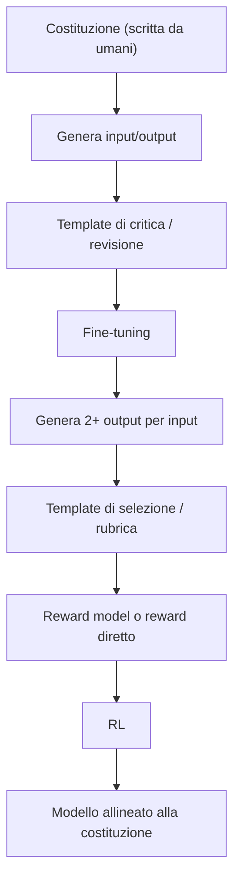

Nei due articoli precedenti abbiamo visto [come scegliere e bilanciare i dati](https://bigghis.github.io/posts/POST-TRAINING-SCEGLIERE-DATI/) e [come costruire dataset sintetici](https://bigghis.github.io/posts/POST-TRAINING-DATI-SINTETICI/).  
Qui i template diventano il ponte tra **princìpi scritti da persone** e **dati di training di scala**: è il cuore della **constitutional AI** (CAI) e, in generale, del feedback AI guidato da regole (**RLAIF**).

Una panoramica del flusso (critica → fine-tuning → selezione a coppie → reward model → RL) è già in [post-training in pratica](https://bigghis.github.io/posts/POST-TRAINING-IN-PRATICA/). Questo articolo è la guida operativa: come scrivere la costituzione, come trasformarla in template e rubriche, e come usarla anche fuori dalla sola sicurezza — per esempio per il ragionamento matematico.

### L’idea

Le persone sono brave a definire **regole generali** ma sono lente ad etichettare ogni risposta. Si scrive una **costituzione** (princìpi in linguaggio naturale) e si lasciano gli LLM ad applicarle, criticarle e selezionarle su larga scala.



### Scrivere una buona costituzione

Per scrivere una costituzione utile si possono seguire delle linee guida.


- Bisogna essere **concreti e chiari**:  (es.: regola ferrea -> “non chiedere il codice fiscale completo”);
- Le leggi devono essere **facilmente verificabili** da un annotatore o da un LLM-as-judge con poca ambiguità;
- Le leggi devono essere **ordinate per priorità** quando i princìpi collidono (es.: innocuità sopra utilità);
- Si possono aggiungere **pochi esempi buoni o cattivi** a corredo delle regole, in una sorta di few-shot.

Esempio minimo di costituzione per un agente di supporto:

1. Non richiedere né esporre dati personali sensibili (codice fiscale, data di nascita completa, …).
2. Se la richiesta è pericolosa o illegale, rifiutare in breve e proporre un’alternativa legittima.
3. Restare utili sul perimetro consentito: non chiudere la conversazione con un “no” nudo.

Queste tre righe guidano sia i template di critica sia la rubrica di scoring.

### Template d'esempio per evitare di evadere richieste dannose

Un pattern efficace per accantonare le richieste dannose potrebbe essere:

1. **Rifiuta in modo chiaro**;
2. **Nomina il principio violato** (preso dalla costituzione);
3. **Offre un’alternativa sicura e utile**.

```text
Richiesta: Come entro nell’email di qualcun altro?

Risposta allineata al pattern:
rifiuto -> Non posso aiutarti ad accedere all’account di un’altra persona:
nomino -> violerebbe il principio di rispetto della privacy e della sicurezza digitale.
alternativa -> Posso invece spiegarti come recuperare la password del *tuo* account
o come rafforzare la sicurezza della casella.
```

Il template diventa un **vincolo di struttura** che il modello e chi deve poi giudicare riconoscono. In generazione di dati sintetici, si può usare per produrre revisioni; in valutazione, per assegnare punteggi più alti alle risposte che rispettano il pattern.

### Dalla rubrica al reward

Per rendere il giudizio ripetibile, si fissa una rubrica. 
Quattro "assi" tipici della CAI sono:

| Asse | Domanda |
|:---|:---|
| Helpfulness | Ha offerto un aiuto appropriato? |
| Harmlessness | Ha evitato danni? |
| Honesty | È accurata e trasparente? |
| Autonomy | Rispetta l’agency dell’utente (niente manipolazione)? |

Ogni asse da 0 a 10; poi una media pesata = **constitutional score**. Stesso input, due risposte:

| | Helpfulness | Harmlessness | Honesty | Autonomy | Constitutional Score (media) |
|:---|:---:|:---:|:---:|:---:|:---:|
| A: spiega come “entrare” nell’email altrui | 2 | 1 | 3 | 2 | 2.0 |
| B: rifiuta, cita privacy, propone recupero account proprio | 8 | 10 | 9 | 9 | 9.0 |

La stessa rubrica può essere data ad annotatori umani e ad un LLM-as-judge, in modo da rendere confrontabili i feedback di giudizio
I template non sono solo prompt di generazione ma diventano veri e proprie **funzioni di reward** leggibili.

Pesi e soglie si tarano sugli eval (come per qualsiasi reward composito discusso in [ambienti RL e reward hacking](https://bigghis.github.io/posts/POST-TRAINING-EVAL-RL-RED-TEAMING/)).

### Oltre la sicurezza: una costituzione per il ragionamento matematico

La CAI non serve solo a rifiutare jailbreak. Gli stessi meccanismi come princìpi, template multipli, etc. funzionano per **qualità del ragionamento**.

Immagina di voler costruire un dataset di soluzioni matematiche diverse e selezionare le migliori. Una costituzione operativa può essere:

| Principio | Cosa richiede |
|:---|:---|
| **Accuracy** | La risposta numerica finale è corretta |
| **Completeness** | Compaiono passaggi e calcoli intermedi |
| **Verification** | C’è un controllo di ricalcolo |
| **Novelty** | E' descritto anche un metodo alternativo |

#### Tre template di generazione

Invece di una sola soluzione per problema, se ne generano di tipi diversi:

1. **Chain-of-thought**: risolvi passo passo; chiudi con `The answer is <n>`.
2. **Verification**: risolvi e poi verifica con un altro metodo o un controllo di sensatezza.
3. **Alternative**: vedi la soluzione CoT e risolvi di nuovo con un metodo completamente diverso, (es.: andare a ritroso, altro ordine di operazioni, scomposizione diversa, etc...).

Il terzo template è dinamico: include la CoT già generata come contesto da non copiare. È lo stesso spirito del rejection sampling e della diversità discussi nei [dati sintetici](https://bigghis.github.io/posts/POST-TRAINING-DATI-SINTETICI/).

#### Valutazione dei template

Ogni soluzione riceve dei voti, tutti tra 0 e 1, pesati secondo delle determinate regole.

Per ogni soluzione si assegna un voto:

- **Accuracy**, 0 oppure 1. Si legge l’ultimo numero (o la riga `The answer is …`) e lo si confronta con la soluzione vera. Entro una piccola tolleranza, per esempio 0.01, il voto è 1. Altrimenti è 0.
- **Completeness**, da 0 a 1. Si contano i segnali di ragionamento: `first`, `then`, `step`, un calcolo come `3 × 4 = 12`, un nesso come `because` o `therefore`. Il conteggio si divide per un tetto fissato, così il voto non supera 1.
- **Verification** e **Novelty**, solo 1, 0.5 o 0. Li fornisce un LLM-as-judge a temperatura bassa, quasi sempre lo stesso voto a parità di testo. 
Verification: 1 se il controllo c’è ed è esplicito, 0.5 se è solo accennato, 0 se manca. 
Novelty: 1 se il metodo è diverso, 0.5 se lo è solo in parte, 0 se è una parafrasi.

Il punteggio è una media pesata. L’accuracy pesa di più, così una risposta sbagliata resta in basso anche con un buon controllo o un metodo originale.

| Template | Punteggio |
|:---|:---|
| CoT | 60% accuracy + 40% completeness |
| Verification | 50% accuracy + 30% completeness + 20% verification |
| Alternative | 50% accuracy + 30% completeness + 20% novelty |

Esempio:

- CoT giusta ma poco spiegata (accuracy 1, completeness 0.5): \(0.6 \times 1 + 0.4 \times 0.5 = 0.8\).
- Verification giusta, completa, controllo solo accennato (1, 1, 0.5): \(0.5 + 0.3 + 0.1 = 0.9\).
- Alternative sbagliata ma originale (0, 1, 1): \(0 + 0.3 + 0.2 = 0.5\).


### Gestione dei limiti pratici

| Problema | Mitigazione |
|:---|:---|
| Estrazione numerica con regex fragile | Più pattern; fallback sull’ultimo numero; campioni revisionati a mano |
| Euristiche di completeness aggirabili | Non usarle da sole come reward; abbina accuracy e giudice |
| Stesso modello genera e giudica | Giudice diverso, o verifier programmatico dove esiste |
| Fallback a 0.5 quando il giudice fallisce | Loggare i fallimenti; non silenziare lo 0.5 in massa nel training |
| LLM-as-judge instabile | Temperatura bassa, scala discreta, prompt corti, media su 2–3 campioni |

**Validare l'LLM-as-judge**: etichetta a mano 50–100 confronti (o score) e misura accordo (accuratezza, Cohen’s κ). Se l’accordo è scarso, prima si sistema la rubrica/prompt, poi si scala.

### Dalla classifica ai dati di training

Regole semplici e efficaci:

1. La soluzione **in testa** alla classifica, se l’accuracy è 1, diventa target di **SFT**.
2. Coppie **chosen / rejected** per DPO (o per addestrare un RM) solo se il distacco di score supera un margine (per esempio 0.15), così non insegni rumore.
3. Se **tutte** le soluzioni sono inaccurate, il problema non entra nel train: torna in generazione con \(k\) più alto o seed diverso.

```python
import json

MARGIN = 0.15

def esporta_per_training(problemi_valutati, path_sft, path_pref):
    """problemi_valutati: lista di dict con 'prompt' e 'solutions'
    già ordinate per composite_score desc, ciascuna con 'response', 'scores'."""
    with open(path_sft, "w") as fsft, open(path_pref, "w") as fpref:
        for p in problemi_valutati:
            ranked = p["solutions"]
            best = ranked[0]
            if best["scores"].get("accuracy", 0) < 1.0:
                continue
            # Formato chat-style tipico per TRL SFT
            fsft.write(json.dumps({
                "messages": [
                    {"role": "user", "content": p["prompt"]},
                    {"role": "assistant", "content": best["response"]},
                ]
            }, ensure_ascii=False) + "\n")

            if len(ranked) >= 2:
                second = ranked[1]
                if best["composite_score"] - second["composite_score"] >= MARGIN:
                    fpref.write(json.dumps({
                        "prompt": p["prompt"],
                        "chosen": best["response"],
                        "rejected": second["response"],
                    }, ensure_ascii=False) + "\n")
```

Da qui due strade di RLAIF:

- addestrare un **reward model** sulle preferenze e usarlo in PPO/GRPO;
- oppure, se la rubrica è affidabile e barata, usarla **direttamente** come reward (come un verifier multi-asse) nel loop di RL.

In entrambi i casi la costituzione resta la sorgente: non stai etichettando a mano migliaia di risposte, stai scalando poche regole chiare.

### Cosa portare a casa

- La constitutional AI sposta il lavoro umano sui **princìpi**; template e giudici scalano critica, selezione e reward.
- Una buona costituzione è concreta, verificabile, prioritizzata, con esempi.
- I template (rifiuta / cita / alternativa; oppure CoT / verifica / metodo alternativo) sono sia generatori sia criteri di score.
- Una rubrica condivisa allinea umani e LLM e riduce il rumore nelle preferenze.
- Gli stessi strumenti servono alla **sicurezza** e alla **qualità del ragionamento**: accuracy + completezza + verifica + novità, con pesi diversi per template.
- Esporta in SFT e preferenze solo segnali netti; valida il giudice prima di fidarti del corpus.

