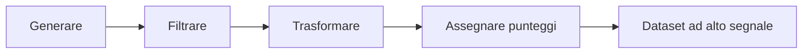
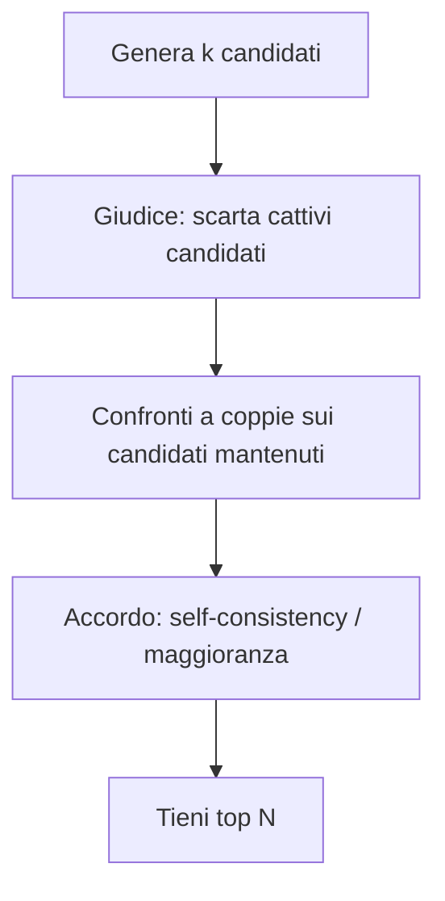
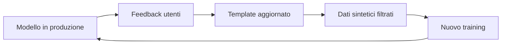

### Perché i dati sintetici

Le persone sono brave a giudicare e a scrivere regole ma il loro apporto è lento e costoso. Gli LLM sono l’opposto: veloci, economici e facili da scalare. Tuttavia l'output prodotto è rumoroso e va filtrato per poter essere utilizzato efficacemente.

Quindi alla **generazione** seguiranno il **filtro** e la **trasformazione** dei dati.


### La pipeline in quattro fasi



Ogni fase può usare un LLM, regole programmatiche, o entrambe. L’ordine è importante perché, ad esempio, filtrare prima di trasformare evita di “abbellire” spazzatura; assegnare punteggi alla fine decide cosa entra in SFT, nelle preferenze o nei rollout.

### Prima di generare

1. **Obiettivo dagli errori.** Il dataset sintetico risponde a un pattern emerso dall’[error analysis](https://bigghis.github.io/posts/POST-TRAINING-ERROR-ANALYSIS/), non a un generico “ci servono più dati”!
2. **Seed reali.** Un seed è un esempio vero (una domanda, un ticket, un log, un problema): ne bastano pochi. Con i **template**, poi, vengono generate varianti intorno a questi casi reali. Senza seed, il modello inventa casi facili e poco utili.
3. **Schema del record.** Un JSONL con provenienza tracciabile, per poterlo filtrare e riprodurre:

```json
{
  "id": "math-0042-k3",
  "split": "train",
  "input": "Quanto fa 37 × 42?",
  "output": "<think>...</think><answer>1554</answer>",
  "meta": {
    "generator": "qwen2.5-72b-instruct",
    "template_id": "cot_v3",
    "temperature": 0.7,
    "n_candidates": 8,
    "kept_rank": 1,
    "scores": {"accuracy": 1.0, "completeness": 0.8},
    "filters": ["single_language", "no_code", "verifier_ok"]
  }
}
```

4. **Holdout e contaminazione.** Tieni un pezzo mai usato per decidere template o filtri, e controlla che i sintetici non siano near-duplicate del test set ([MinHash e leakage](https://bigghis.github.io/posts/POST-TRAINING-DATI-TOKEN/)).
5. **Licenze e ToS.** Verifica se il modello generatore consente l’uso degli output per addestrare altri modelli; non tutti lo permettono allo stesso modo.

### Generare

Tre leve pratiche:

- **Template di prompt** sui seed: `"Risolvi passo passo: {question}"`, loop sui seed.
- **Diversità di campionamento**: temperatura e top-p più alti per esplorare; più bassi per risposte stabili da tenere come target.
- **Espansione del compito**: riscrivere un problema in versione più facile o più difficile; far rispondere con **persona** diverse (studente, tutor, revisore) per variare tono e struttura.

#### Rejection sampling

Il problema tipico: su certi input il modello sbaglia quasi sempre. Se generi una sola risposta e la scarti, quegli input **scompaiono** dal dataset. Il **rejection sampling** (campionamento con rifiuto) genera \(k\) candidati e tiene i migliori (best-of-\(k\)).

```text
Input:  Quanto fa 37 × 42?
A: 1600   ← scarta
B: 1564   ← scarta
C: 1554   ← tieni (verifier OK)
```

Con vLLM si possono chiedere più completamenti per prompt:

```python
from vllm import LLM, SamplingParams

llm = LLM(model="Qwen/Qwen2.5-7B-Instruct")
params = SamplingParams(temperature=0.8, top_p=0.95, n=8, max_tokens=512)

outputs = llm.generate(["Quanto fa 37 × 42? Spiega i passaggi."], params)
candidati = [o.text for o in outputs[0].outputs]

def verifier(testo: str, atteso: int = 1554) -> bool:
    # estrazione semplificata: ultima sequenza di cifre
    import re
    nums = re.findall(r"-?\d+", testo.replace(",", ""))
    return bool(nums) and int(nums[-1]) == atteso

tenuti = [c for c in candidati if verifier(c)][:1]
```

Se dopo \(k\) tentativi non resta nulla di valido, non “forzare” un esempio sbagliato: alza \(k\), cambia template, usa un generatore più capace o marca quel seed come scoperto e trattalo a parte (dati umani, o problema da riformulare).

Il giudice può essere un verifier programmatico (matematica, test di unità, schema JSON) oppure un **LLM as a judge** guidato da regole — idea che riprenderemo con la [constitutional AI](https://bigghis.github.io/posts/POST-TRAINING-CONSTITUTIONAL-AI/).

### Filtrare

Senza filtro, generare di più peggiora il modello. Con un buon filtro, puoi generare con maggior  confidenza di star creando dati utili.

| Tipo di filtro | Esempi |
|:---|:---|
| Regole | Formato dei tag, lunghezza min/max, lingua unica, niente codice se non richiesto |
| Qualità | Tossicità, volgarità, accuratezza, coerenza, pertinenza al prompt |
| Verifier “in un altro modo” | Ricalcolo con metodo diverso; test automatici sul codice |
| Collapse / dedup | Exact match, MinHash, similarità semantica |
| Maggioranza | Tra più candidati, tieni ciò che concorda sul risultato |
| LLM giudice | Costituzione / rubrica → elimina i peggiori → confronti a coppie → top N |

Pipeline tipica con giudice:


Esempio di filtro creato per non tenere due volte lo stesso esempio. Se due testi sono troppo simili, se ne tiene uno solo. 
Per trovare la similarità di due testi, li si trasforma in vettori e si calcola la vicinanza semantica (cosine similarity) tra essi. 

```python
from sentence_transformers import SentenceTransformer
from sklearn.metrics.pairwise import cosine_similarity
import numpy as np

model = SentenceTransformer("all-MiniLM-L6-v2")
emb = model.encode(testi, normalize_embeddings=True)
sim = cosine_similarity(emb)

tenere = []
usati = np.zeros(len(testi), dtype=bool)
for i in range(len(testi)):
    if usati[i]:
        continue
    tenere.append(i)
    usati |= sim[i] >= 0.92   # soglia da calibrare sul dominio
```

Nell'esempio, se la similarità tra due testi è maggiore di 0.92, se ne mantiene uno solo.

### Trasformare

È la fase più sottoutilizzata: spesso si hanno già dati utili, ma nel formato sbagliato.

| Trasformazione | A cosa serve |
|:---|:---|
| Distillazione | Da CoT verbosa a risposta concisa (o viceversa: espandere in passaggi) |
| Normalizzazione | Stesso tono/stile in tutto il dataset |
| Augmentation | Parafrasi del prompt, traduzione, varianti passo-passo |
| Curriculum | Bucket easy / medium / hard, allineati alla difficoltà moderata utile in RL |
| Reformat | Documentazione, wiki, ticket → coppie `{input, target}` per SFT |

Esempio di distillazione:

```text
Grezzo (verboso):
Step 1: la Terra ti attira… Step 2: tu attiri la Terra… Step 3: …

Trasformato:
La gravità è un’attrazione reciproca tra masse; la massa enorme della Terra la rende dominante.
```

### Assegnare punteggi

Tre modi complementari:

1. **Giudice multi-asse** che restituisce JSON e una soglia (per esempio tenere solo `final_score > 0.7`):

```json
{
  "correctness": 0.9,
  "completeness": 0.8,
  "conciseness": 0.7,
  "style_fit": 0.6,
  "final_score": 0.75
}
```

2. **Crediti parziali euristici** (conteggio di “step”, calcoli intermedi, frasi come “perché / quindi”): utili come segnale debole, **facili da aggirare** se il modello impara a riempire di parole chiave. Non usarli da soli come reward in produzione.
3. **Confronti a coppie** (“quale è migliore?”) per costruire preferenze per il reward model o per DPO.

### Template engineering

Invece di correggere migliaia di esempi a mano, si lavora su diverse **varianti di template**. Si corregge il template quando l’error analysis mostra un pattern; il template genera poi molti esempi coerenti.

Esempio “mad-lib” per il supporto clienti:

```text
Ciao {{customer_name}}, capisco il problema con {{product_name}}:
{{specific_issue}}. Ho provveduto a {{resolution_step}}.
```

Con liste di valori per ogni slot si ottengono combinazioni diverse senza riscrivere ogni messaggio.
Versionare i template nei metadati del JSONL può essere utile per sperimentarne diverse varianti di  senza doverne riscrivere ogni volta da capo.

Quando il modello è in produzione e gli utenti forniscono un certo feedback, avendo a disposizione i template, questi si possono modificare per adattarli ai feedback ricevuti.
Dal template adattato escono esempi nuovi, che si filtrano e si usano per riaddestrare il modello. Poi il ciclo riparte.

#### Il ciclo in produzione



### Strumenti

Per creare e controllare i dataset sintetici ci si può appoggiare a strumenti utili. [vLLM](https://github.com/vllm-project/vllm){:target="_blank"} genera tante risposte in poco tempo. La libreria [`datasets`](https://huggingface.co/docs/datasets){:target="_blank"} di Hugging Face tiene insieme i dati e li mixa. [distilabel](https://github.com/argilla-io/distilabel){:target="_blank"} collega generazione, giudice e preferenze in una sola pipeline. [Argilla](https://github.com/argilla-io/argilla){:target="_blank"} si può usare quando una persona deve rivedere un campione e segnare cosa tenere, etc.

Gli stessi controlli si fanno anche sul testo già generato. `sentence-transformers` e [`datasketch`](https://github.com/ekzhu/datasketch){:target="_blank"} trovano i duplicati, per significato e per parole. fastText riconosce la lingua, Llama Guard e Detoxify segnalano tossicità e contenuti rischiosi. [TRL](https://huggingface.co/docs/trl){:target="_blank"} scrive i dati nei formati usati da fine-tuning, DPO e GRPO. Per variare il tono dei prompt, un dataset di profili come [Persona Hub](https://huggingface.co/datasets/proj-persona/PersonaHub){:target="_blank"} basta a non far uscire sempre la stessa voce.

Non serve usarli tutti. Un minimo che funziona è un generatore (un’API o vLLM), qualche regola o un verifier, un giudice, `datasets` e una revisione umana a campione, per esempio con Argilla.

### Controlli finali e trappole

- **Leggere a campione**: anche 50–100 esempi letti da una persona esperta evitano disastri silenziosi.
- **Ablation**: confronta un piccolo set **curato** con un grosso set sintetico filtrato. Se il curato vince, il filtro non basta ancora.
- **Omogeneizzazione**: troppa sintesi dallo stesso modello appiattisce stile e copertura; mescola generatori, temperature, persona e seed reali.
- **Bias del generatore**: errori sistematici del teacher passano agli studenti.
- **Self-preference**: se lo stesso modello genera e giudica, tende a preferire “se stesso”. Usa un giudice diverso (o regole/verifier) quando puoi.

### Cosa portare a casa

- I dati sintetici scalano solo se **generazione + filtro + trasformazione + punteggio** lavorano insieme.
- Parti da **error analysis e seed reali**, con JSONL tracciabile e split puliti.
- **Rejection sampling** e filtri (lingua, codice, dedup, verifier) decidono se 600k esempi sono un asset o un costo.
- Lavora sui **template**, non sui singoli sample; versionarli è parte del mestiere.
- Misura sempre contro un set curato piccolo e contro gli eval: la velocità non è qualità.
