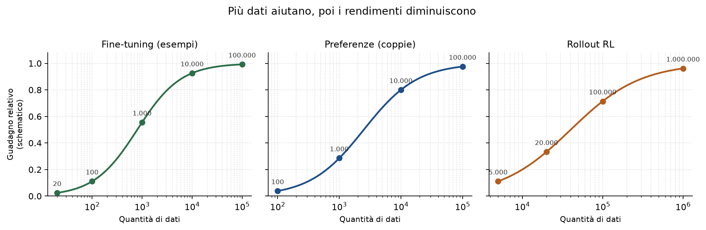
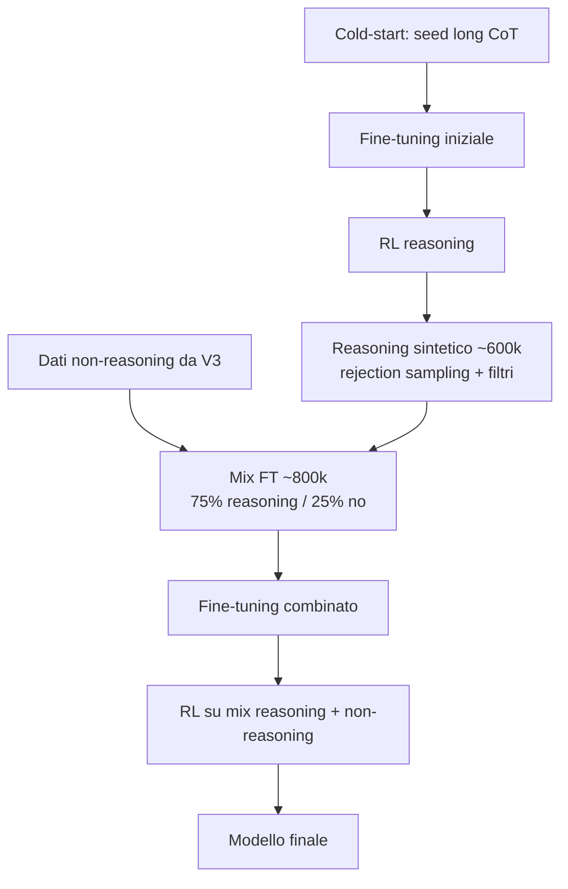

*Garbage in, garbage out*

Quando si usano dati per il training, se i dati sono rumorosi o incoerenti, l'algoritmo di post-training li applicherà al modello così come sono e quando useremo quest'ultimo in inferenza l'output produrrà la stessa scarsa qualità (garbage).

Il **pre-training** e il **post-training** usano i dati in modi diversi. Nel pre-training conta soprattutto la **scala**: il modello deve imparare capacità generali su un mare di testo. Un punto di riferimento è il paper [Chinchilla](https://arxiv.org/abs/2203.15556){:target="_blank"} (Hoffman et al., 2022): un modello da 10 miliardi di parametri, in quella logica, andrebbe addestrato su circa 200 miliardi di token. GPT-3, per esempio, è stato pre-addestrato su circa 300 miliardi di token.

Il post-training serve ad **affinare il comportamento** di un modello. I dataset sono più piccoli di ordini di grandezza: ChatGPT, per esempio, ha usato circa **13.000** esempi di fine-tuning e **migliaia** (comunque meno di un milione) di preferenze per il reward model. Più dati aiutano ancora, ma molto meno della loro qualità. Nella pratica, **100 esempi curati battono 10.000 esempi rumorosi**, anche se questi ultimi sono sintetici e facili da produrre.

Questa differenza di scala va tenuta sempre presente: i dati di pre-training sono enormemente più numerosi di quelli di post-training. Nel post-training non si “ricrea” da zero ciò che manca nel modello base ma si raffina e si allinea.

### Quanti dati servono

La quantità giusta dipende da **cosa sa già** il modello che si sta addestrando. Prima di raccogliere migliaia di esempi, conviene sempre [valutare il modello base](https://bigghis.github.io/posts/POST-TRAINING-ERROR-ANALYSIS/) e vedere dove fallisce.

Un esempio chiaro: vuoi che il modello gestisca un nuovo formato d’esame di calcolo.

| Cosa sa già il modello | Quanti esempi tipicamente bastano |
|:---|:---|
| Conosce già il calcolo; serve solo il nuovo formato | ~20 problemi di pratica |
| Non ha mai visto il calcolo; deve imparare l’intera materia + formato | migliaia di esempi |
| Non ha quasi mai visto la matematica | centinaia di migliaia di esempi |

Se una capacità non c’è nel pre-training, il post-training non la inventa a basso costo. Per questo si parte **in piccolo**, si legge il segnale sugli eval, e si scala solo quando l’ipotesi tiene, fino ai **rendimenti decrescenti**.


_I numeri sono ordini di grandezza empirici._

| Scala | Fine-tuning | Preferenze (reward model) | Rollout RL |
|:---|:---|:---|:---|
| Piccola | ~20: cambiamenti di formato | ~100: tono, cortesia, rifiuti semplici | 5k–20k: capire se il reward model muove davvero l'LLM |
| Media | ~100–1k: si vede un cambiamento reale; 1k è spesso il punto di svolta per compiti di dominio | 1k–10k: distinzioni più sottili (fattualità vs. lunghezza, innocuità vs. utilità) | 20k–100k: aggiornamenti di media scala |
| Grande | 10k: tipico dei lab di frontiera; 100k: adattamento di dominio | ~100k: copertura multi-dominio / open QA | 100k–1M+: allineamento ampio; oltre, compute e memoria diventano il vincolo |


### Dati per il fine-tuning

La forma dei dati per il fine-tuning è quella già vista in [dati e token](https://bigghis.github.io/posts/POST-TRAINING-DATI-TOKEN/): coppie `{input, target output}`. Se serve il ragionamento, il target include i passaggi (per esempio tra tag `<think>`) e la risposta finale.

Si possono anche insegnare **tag personalizzati**. Esempio: l’input contiene un blocco `<api>` con il meteo del giorno, e l’output deve rispondere al problema *e* produrre un tag `<display_weather>` con l’emoji da mostrare in interfaccia. Il modello impara a trattare quei tag come parte del contratto input/output.

```text
Input:
<api>Today’s weather is sunny</api>
Alice ha 3 mele e ne compra altre 2 nei giorni di sole. Quante ne ha ora?

Target:
<think>
Parto da 3. Ne compra 2 ⇒ 3+2=5.
</think>
<answer>5</answer>
<display_weather>☀</display_weather>
```

#### Il ciclo iterativo

Non si costruisce il dataset “definitivo” al primo tentativo. Si lavora sui fallimenti, come nell’error analysis:

1. Partire con ~**20** esempi e un fine-tuning LoRA.
2. Valutare e trovare il **peggior pattern** di errore.
3. Aggiungere **3–5 esempi vicini** che contrastano quel pattern.
4. Fare di nuovo il training, rivalutare, ripetere.

Esempi tipici di fix mirati:

| Pattern trovato | Cosa aggiungere |
|:---|:---|
| Omette `<display_weather>` quando “sunny” è accanto a una punteggiatura | Vicini con punteggiatura, sinonimi (“bright sunshine”), maiuscole diverse |
| Usa l’emoji sbagliata per “clear skies” | Controesempi espliciti (cielo sereno → ☀, non ☁) |
| Senza tag `<api>` “perde” comunque i tag di ragionamento o meteo | Esempi **senza** tag API, con risposta diretta e senza leak |
| Schema non rispettato (spazi, tag aperti, campi mancanti) | Esempi con aderenza stretta allo schema |

Importante: quando si aggiungono i vicini, **variare anche l’input** (altro problema di matematica, altri numeri), altrimenti il modello memorizza un solo esempio.

#### Quando fermarsi

Non quando la loss sul training continua a scendere. Quando gli **eval** dicono che il modello è abbastanza buono (o meglio di quello in produzione), con controlli automatici sugli aspetti che contano:

- regex sullo schema dei tag;
- mappatura semantica (“sunny / clear / bright” → ☀);
- verifier sulla risposta (in matematica: confronto numerico).


### Dati per l’RL

Nell’RL non c’è un target fisso. Servono soprattutto:

1. una **lista di input** vari, con buona copertura del compito;
2. i **rollout** (le risposte che il modello genera a partire da un input) `{input, output}`, più di una per input;
3. le **trajectory** (quelle risposte, con il punteggio che hanno ricevuto) `{input, output, reward}`, dopo la valutazione dei grader;
4. se c’è un reward model, le **preferenze** `{input, output A, output B, preferenza}`.

Le stesse regole del fine-tuning valgono anche qui: qualità e diversità contano più della mole.

#### Regole pratiche sui rollout

**Non tutti i rollout sono utili.** Molti sono ridondanti o troppo simili. Conviene filtrare e tenere il sottoinsieme ad alto segnale: costa meno e impara meglio.

**Difficoltà moderata.** Input troppo facili o troppo difficili danno reward poco discriminanti — lo stesso problema che si affronta con l’[advantage in GRPO](https://bigghis.github.io/posts/POST-TRAINING-PPO-GRPO/). In pratica si possono tenere i prompt su cui, su \(k\) campioni, il tasso di successo non è né 0 né 1:

```python
def prompt_utili(prompt_to_rewards, lo=0.15, hi=0.85):
    """prompt_to_rewards: dict[str, list[float]] con reward in [0, 1]."""
    tenuti = []
    for prompt, rewards in prompt_to_rewards.items():
        rate = sum(r > 0.5 for r in rewards) / max(len(rewards), 1)
        if lo < rate < hi:
            tenuti.append(prompt)
    return tenuti
```

**Reward rumorosi.** Se il reward model è incerto, quel segnale fa più danno che utilità. Si possono scartare le trajectory con alta incertezza del RM (per esempio alta varianza tra campioni del giudice, o confidenza bassa).

**Reward composito.** Un solo punteggio è spesso troppo povero. Meglio componenti (fattualità, stile, completezza, sicurezza) e una somma pesata, come già discusso per i [grader e il reward hacking](https://bigghis.github.io/posts/POST-TRAINING-EVAL-RL-RED-TEAMING/).

**Calibrazione del reward model.** I RM tendono a sovra apprendere tratti superficiali. Classico: “più lungo = meglio”. Per contrastare, si possono aggiungere controesempi: risposte lunghe ma scadenti e risposte brevi ma eccellenti.

**Divario rispetto al giudizio umano.** Se il RM dà 42 e l’eval umano dà 20 sulla stessa risposta, quel gap (a volte chiamato *alignment tax* in senso ampio) va chiuso con esempi mirati: alto reward / basso giudizio umano e viceversa, e con split train/eval delle preferenze ben fatti.

**Offline vs online.** Offline: si raccoglie un set di preferenze, si addestra il RM, si congela. Stabile, riproducibile, limitato dalla copertura iniziale — è il punto da cui partire. Online: il RM si aggiorna mentre l’LLM migliora (preferenze su output nuovi, click, altri segnali). Più adattivo, più costoso.

**Reward lenti o costosi.** Verifier pesanti (catene di ragionamento lunghe, benchmark di performance del codice su più dispositivi) non vanno eseguiti a ogni step. Si schedulano in modo selettivo, facendo attenzione a non mescolare punteggi di un LLM “vecchio” con quelli di uno già aggiornato.

Scala tipica del RM: poche decine/centinaia di coppie bastano per tratti grossolani (cortesia); migliaia per trade-off sottili; centinaia di migliaia se il dominio è aperto e multi-intento.

### Mettere fine-tuning e RL nello stesso pipeline

Nella produzione reale non c’è un solo dataset ma ce ne sono diversi, che alimentano fasi diverse. La pipeline di [DeepSeek-R1](https://arxiv.org/abs/2501.12948){:target="_blank"} è un buon caso concreto (già abbozzata in [post-training in pratica](https://bigghis.github.io/posts/POST-TRAINING-IN-PRATICA/)); qui guardiamo i **dati**.



In sintesi, le parti principali sono:

| Dataset | Ruolo |
|:---|:---|
| Seed **cold-start** con long chain-of-thought | Pochi esempi, molto dettagliati: insegnano formato e stile di ragionamento |
| Dati di fine-tuning “normali” (stile V3) | Coppie input/output senza CoT esplicito |
| Reasoning **sintetico** (~600k) | Generato in massa, poi filtrato |
| Non-reasoning (~200k) | Risposte dirette / con meno passaggi |
| Mix finale (~800k) | Circa 75% reasoning, 25% non-reasoning, prima di altri round di RL |

Sul reasoning sintetico i filtri contano quanto la generazione: **rejection sampling** (generare molte risposte e tenere le migliori), rimozione delle risposte che **mescolano lingue**, rimozione del **codice** quando non è richiesto. Senza questi passaggi, 600k di esempi diventano 600k di rumore.

Il messaggio operativo: pianificare **più** dataset, ciascuno con uno scopo, e unire solo dopo averli puliti. Come costruire e filtrare i pezzi sintetici lo vediamo in dettaglio [sui dati sintetici](https://bigghis.github.io/posts/POST-TRAINING-DATI-SINTETICI/).

### Bilanciare dati e reward

Anche con dataset puliti, le **proporzioni** decidono il comportamento. Il trade-off classico è **generalizzazione contro specializzazione**.

Se addestri al 90% su domande di coding e al 10% su testo generale, il modello diventerà bravissimo a programmare e potrà fallire su “di che colore è il cielo?”. Un riequilibrio empirico tipico potrebbe essere 60% QA generale, 30% coding, 10% sicurezza — ma i numeri giusti si trovano solo con esperimenti piccoli a percentuali diverse, guidati dagli eval e dall’uso reale degli utenti.

Con `datasets` di Hugging Face si può, ad esempio, creare un dataset misto con:

```python
from datasets import interleave_datasets

dati_misti = interleave_datasets(
    [qa_generale, coding, safety],
    probabilities=[0.60, 0.30, 0.10],
    seed=42,
    stopping_strategy="all_exhausted",
)
```

A volte il conflitto non si risolve con un unico mix. Se migliorare le lingue a poche risorse peggiora le lingue principali (quelle che usano davvero i clienti), conviene separare: **adapter LoRA diversi** per compito, o modelli diversi, invece di un solo compromesso mediocre.

Lo stesso vale per i **pesi del reward**. Se il RM massimizza solo l’utilità, il modello può rispondere anche con consigli azzardati.Per contrastare si ribilancia, per esempio:

\[
R = 0.4 \cdot \text{helpfulness} + 0.4 \cdot \text{safety} + 0.2 \cdot \text{truthfulness}
\]

Se la concisione è andata troppo oltre (“Perché dormire è importante?” → “Fa bene”), non esiste un ottimo unico: si lavora sulla **frontiera di Pareto** tra brevità e completezza, oppure si intagliano eccezioni nei dati:

| Scenario | Comportamento desiderato |
|:---|:---|
| Trivia / fatti (“Capitale della Francia?”) | Una riga: “Parigi.” |
| Domande causali / esplicative | Risposta con profondità |
| Input ambiguo (“Parlami di Python”) | Chiedere un chiarimento prima di sparare una tesi |

Infine: specializzandosi, qualche capacità generica può indebolirsi. Prima di “sistemarla”, chiediti se ti serve ancora. Gli eval di business contano più delle classifica generiche sul web, se il prodotto è uno specialista.

Il bilanciamento **non finisce mai**: in produzione la distribuzione degli utenti cambia, e mix e reward vanno ritarati.

### Cosa portare a casa

- **Garbage in, garbage out**: nel post-training la qualità batte la quantità; il pre-training usa ordini di grandezza più dati.
- **Prima gli eval sul modello base**, poi dataset piccoli, poi scala fino ai rendimenti decrescenti.
- **Fine-tuning**: coppie mirate, ciclo error analysis → pochi esempi di fix → rivalutazione; LoRA per iniziare; full FT solo se serve davvero.
- **RL**: input diversificati, rollout filtrati, difficoltà moderata, RM calibrato; partire offline e complicare dopo.
- **Pipeline reale**: più dataset con ruoli diversi (seed, reasoning filtrato, non-reasoning, preferenze), poi mix consapevole.
- **Mix e reward** si regolano sugli eval e sull’uso reale, non a tavolino una volta per tutte.

Checklist operativa:

1. Cosa sa già il modello base su questo compito?
2. Qual è il minimo set che può falsificare la mia ipotesi di fix?
3. Sto ottimizzando qualità e copertura, o solo la dimensione del file?
4. Fine-tuning e RL hanno ciascuno i dati nella forma giusta?
5. Dopo il mix, gli eval di specializzazione *e* di regressione sono ancora verdi?

Nel [prossimo articolo](https://bigghis.github.io/posts/POST-TRAINING-DATI-SINTETICI/) vedremo come **generare, filtrare, trasformare e valutare** dati sintetici in modo che restino ad alto segnale — la leva con cui si scalano davvero i dataset di post-training.
