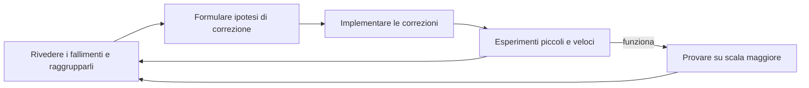

Nei due articoli precedenti abbiamo visto come si misura un modello: [test set e metriche](https://bigghis.github.io/posts/POST-TRAINING-EVAL-METRICHE/) e [ambienti di test per il RL](https://bigghis.github.io/posts/POST-TRAINING-EVAL-RL-RED-TEAMING/).  
Questo articolo parla del passaggio successivo, l'**error analysis** (analisi degli errori): come si scompongono gli errori di un modello, come si raggruppano per trovare degli schemi ricorrenti, quale intervento scegliere per ciascuno, e come si costruiscono eval che rendano tutto questo possibile.

### Perché l'error analysis è fondamentale

Prendiamo due modelli, A e B, entrambi con un'accuratezza dell'80%. Guardando solo il numero sembrano equivalenti. Ma se guardiamo **dove** sbagliano, scopriamo che il modello A fallisce soprattutto sulle divisioni, mentre il modello B fallisce soprattutto sui ragionamenti con contesti lunghi.

Le correzioni sono completamente diverse. Per il modello A conviene aggiungere esempi di divisioni più difficili ai dati di fine-tuning. Per il modello B conviene aggiungere problemi di matematica più lunghi e complessi, con verifier adatti, all'ambiente di RL. Lo stesso 80% richiede due interventi diversi, e solo l'analisi degli errori permette di sceglierli.

#### Un processo ricorsivo

Sulla carta il procedimento è lineare: si parte dal punteggio, si scompongono i fallimenti in categorie e si fa una correzione mirata per ciascuna. Nella pratica è molto meno ordinato.

Si propongono alcune correzioni, per esempio X, e si provano con **esperimenti piccoli**, che danno risultati in fretta. Spesso falliscono tutti. A quel punto bisogna scavare più a fondo, e analizzare non solo gli errori originali ma anche quelli dei X nuovi prodotti dagli esperimenti. Da lì nascono nuove ipotesi e nuovi esperimenti, sempre piccoli. Magari due funzionano e uno no. Si provano allora delle combinazioni dei due che hanno funzionato, e se una regge si prova su scala maggiore, per esempio con 10 volte i dati. E mentre si fa crescere quella, si scopre che un altro esperimento sembrava ancora più promettente.



È un processo ricorsivo: si fa error analysis sugli errori, poi sugli errori dei modelli che dovevano correggerli, e così via. Per questo avere molta potenza di calcolo è così utile: permette di far girare molti esperimenti in parallelo, e nella realtà se ne lanciano moltissimi in parallelo.

La qualità dell'analisi fa la differenza. Una **buona error analysis** porta al modello migliore con pochi esperimenti, perché le ipotesi sono quelle giuste. Una **cattiva error analysis** fa girare a vuoto: si continuano a lanciare esperimenti e il modello non migliora mai.

#### Un caso reale: GPT-4o troppo accondiscendente

Nel 2025 molti utenti hanno segnalato che GPT-4o era diventato troppo **sycophantic** (accondiscendente): dava ragione all'utente e lo lodava anche quando non era il caso. OpenAI non è partita subito con le correzioni. Prima ha costruito degli **eval** mirati, per confermare il problema e individuare in quali esempi si manifestava. Solo dopo, guidata da quegli eval, ha corretto il modello.

### Diagnosticare un errore è difficile

Un errore singolo, anche quando è evidente, raramente dice da dove viene. Prendiamo questa risposta:

```text
Input:  Quanto fa 23 ÷ 13?
Output: Passo 1: 23 ÷ 13 ≈ 1,7
        Passo 2: il resto è 10 → 10 ÷ 13 ≈ 0,77
        Passo 3: sommo: 1,7 + 0,77 = 2,47
        Risposta finale: 2,47
Target: 23 ÷ 13 ≈ 1,769
```

La risposta è sbagliata, ma perché? Il modello ha mescolato una stima iniziale (1,7, che contiene già la parte decimale) con un ragionamento successivo sul resto, contando due volte la stessa cosa. È un problema di divisione? Di ragionamento a più passaggi? Di come il modello organizza i passaggi?

Con un solo esempio la tentazione è concludere che *"il modello non sa fare le divisioni"*. Ma supponiamo di trovare un secondo esempio, *"23 ÷ 13"* senza punto interrogativo, a cui il modello risponde correttamente. Allora il problema forse non ha niente a che fare con la divisione: potrebbe dipendere dal modo in cui è formulata la domanda.

**Un esempio non basta per fare una diagnosi.** Servono molti esempi, raggruppati in modo da far emergere degli schemi. Solo vedendo la "forma" dell'errore si può proporre la correzione giusta.

### Raggruppare gli errori

Il primo modo di raggruppare gli errori è manuale: si leggono i fallimenti uno per uno e si annotano le somiglianze. Non è affatto un cattivo inizio, anzi, è il modo migliore per farsi un'idea. Ma con centinaia o migliaia di errori servono strumenti automatici.

#### Con gli embedding e il k-means

Un **modello di embedding** trasforma un testo in un vettore di numeri, in modo che testi con significato simile abbiano vettori vicini. Per misurare quanto due testi sono simili si usa la **cosine similarity** (similarità del coseno), un prodotto scalare tra i due vettori normalizzati: vale 1 per testi con significato identico e scende man mano che i significati si allontanano. Per esempio *"Quanto fa 23 ÷ 13?"* e *"Dividi 23 mele tra 5 persone in parti uguali"* hanno una similarità di 0,89, perché parlano entrambi di divisioni.

Per formare dei gruppi si usa poi un algoritmo di clustering come il **k-means**, che funziona così:

1. si decide quanti gruppi si vogliono, per esempio 3;
2. l'algoritmo sceglie 3 punti di partenza, chiamati **centroidi**;
3. ogni testo (cioè il suo embedding) viene assegnato al centroide più vicino;
4. ogni centroide si sposta nella posizione media dei punti che gli sono stati assegnati;
5. si ripetono i passi 3 e 4 finché i gruppi smettono di cambiare.


_Gli embedding veri hanno centinaia di dimensioni; qui sono rappresentati in 2D per semplicità._

Alla fine si ottengono gruppi di testi con significato simile. In codice bastano poche righe:

```python
from sentence_transformers import SentenceTransformer
from sklearn.cluster import KMeans

embedding_model = SentenceTransformer("all-MiniLM-L6-v2")
embeddings = embedding_model.encode(domande_sbagliate)       # una riga per errore

kmeans = KMeans(n_clusters=3, random_state=42)
cluster_labels = kmeans.fit_predict(embeddings)              # il gruppo di ogni errore
```

Il risultato va poi **letto**. Per ogni gruppo conviene stampare qualche esempio e chiedersi cosa abbiano in comune:

```python
from collections import defaultdict

gruppi = defaultdict(list)
for domanda, gruppo in zip(domande_sbagliate, cluster_labels):
    gruppi[gruppo].append(domanda)

for gruppo, domande in sorted(gruppi.items(), key=lambda g: -len(g[1])):
    print(f"\nGruppo {gruppo}: {len(domande)} errori")
    for d in domande[:5]:
        print("  -", d[:100])
```

Il numero di gruppi va scelto a mano. Un modo pratico è provare alcuni valori e confrontarli con il **silhouette score** di scikit-learn, che misura quanto i gruppi sono compatti e ben separati (più è alto, meglio è):

```python
from sklearn.metrics import silhouette_score

for k in range(2, 9):
    labels = KMeans(n_clusters=k, random_state=42).fit_predict(embeddings)
    print(k, round(silhouette_score(embeddings, labels), 3))
```

Il punteggio è solo un'indicazione. Alla fine conta se i gruppi hanno senso per chi li legge.

#### Con un LLM

Il secondo strumento è un LLM. Il clustering con gli embedding raggruppa le domande per **argomento**, ma non dice **perché** il modello ha sbagliato. Un LLM invece può leggere la domanda, la risposta corretta e la risposta del modello, e classificare il tipo di errore.

Si definisce un elenco di categorie e si chiede all'LLM di sceglierne una:

```python
ERROR_CATEGORIES = [
    "calculation_error",    # errori di calcolo
    "reasoning_error",      # errori di ragionamento
    "incomplete_solution",  # risposta parziale o non finita
    "format_error",         # risposta nel formato sbagliato
    "other",                # altro
]

def classifica_errore(llm, domanda, corretta, predetta, risposta_modello):
    prompt = f"""Analyze this math error and categorize it.

PROBLEM: {domanda}
CORRECT ANSWER: {corretta}
MODEL SOLUTION: {risposta_modello[:1500]}
PREDICTED ANSWER: {predetta}

Choose ONE category: {', '.join(ERROR_CATEGORIES)}
Respond with just the category name."""

    output = llm(prompt).strip().lower()
    for categoria in ERROR_CATEGORIES:
        if categoria in output or categoria.replace("_", " ") in output:
            return categoria
    return "other"
```

Due dettagli pratici. Il prompt include anche i **passaggi** della risposta del modello, non solo il numero finale: senza vederli, l'LLM non può distinguere un errore di calcolo da un errore di ragionamento. E la risposta dell'LLM va interpretata con prudenza, accettando anche *"reasoning error"* scritto con lo spazio e ricadendo su `other` quando non si riconosce nessuna categoria.

Un LLM può fare anche di più: ricevere centinaia di fallimenti tutti insieme e **riassumerli**. A un prompt come *"Ecco 500 risposte sbagliate: quali schemi ricorrenti vedi, in che percentuale, e quali correzioni suggerisci?"* può rispondere con qualcosa del tipo:

```text
- 40% sono troppo prolisse: esitazioni e frasi di riempimento inutili
- 23% contengono errori fattuali detti con grande sicurezza
- 15% falliscono su casi limite: caratteri speciali e input lunghi
Correzioni suggerite: ...
```

Le percentuali e le correzioni proposte vanno sempre verificate, ma come punto di partenza è molto più veloce che leggere 500 risposte.

I due strumenti si combinano bene. Incrociando i gruppi del k-means (l'argomento) con le categorie dell'LLM (il tipo di errore) si vede, per esempio, che i problemi di percentuali sbagliano soprattutto per errori di calcolo, mentre quelli con molti passaggi sbagliano soprattutto per errori di ragionamento:

```python
import pandas as pd

df = pd.DataFrame({"gruppo": cluster_labels, "categoria": categorie})
print(pd.crosstab(df["gruppo"], df["categoria"]))
```

### Dagli errori agli interventi

Una volta individuate le categorie di errore, bisogna capire da dove vengono e come correggerle.
Un elenco di categorie per esempio:


| Categoria di errore | Sintomi tipici | Cause probabili |
|:---|:---|:---|
| Factuality / hallucination (allucinazioni) | Affermazioni sbagliate dette con sicurezza, citazioni inventate | Poca supervisione ancorata a fonti; dati sintetici senza evidenze |
| Ragionamento (matematica, logica, codice) | Passaggi intermedi sbagliati, errori di calcolo, casi limite falliti | Pochi esempi con i passaggi; mix di difficoltà sbilanciato |
| Schema / formato | JSON o XML non validi, chiavi sbagliate, campi in più | Pochi esempi con lo schema imposto; stili di etichettatura misti |
| Instruction following (seguire le istruzioni) | Ignora campi, lunghezza o stile richiesti | Training dominato da chat libera; pochi segnali negativi |
| Uso di tool e API | Tool sbagliato o argomenti sbagliati, passaggi successivi mancanti | Poche dimostrazioni di chiamate a tool; nessuna traccia a più passi |
| Under-refusal (rifiuti mancati) | Risponde a richieste vietate | Pochi esempi di rifiuto; regole coperte in modo incompleto |
| Over-refusal (rifiuti eccessivi) | Rifiuta richieste innocue | Troppo peso ai dati di sicurezza; preferenze troppo prudenti |
| Tossicità / bias | Linguaggio dannoso, stereotipi | Supervisione sbilanciata; mancano esempi controfattuali |
| Stile / tono | Troppo lungo, esitante o troppo secco | Un solo stile domina i dati; bias del giudice |
| Grounding (uso del contesto fornito) | Ignora il contesto, cita la parte sbagliata | Pochi esempi contesto-risposta; mancano esempi negativi difficili |
| Contesto lungo | Dimentica informazioni iniziali, errori nei riferimenti incrociati | Dati con contesti brevi; nessuna supervisione su più documenti |
| Incoerenza tra i turni | Si contraddice, perde i vincoli nel corso della conversazione | Pochi dialoghi con stato e storie di chat varie |
| Overconfidence (eccesso di sicurezza) | Risposte sbagliate con alta confidenza, non si astiene mai | Nessun target che esprima incertezza |
| Fragilità al cambio di distribuzione | Peggiora con parafrasi o domini nuovi | Input poco vari; overfitting sui template |

Per ogni categoria, la correzione può passare dal fine-tuning (cambiando i dati) o dal RL (cambiando le preferenze o i grader):

| Categoria di errore | Intervento con il fine-tuning | Intervento con il RL |
|:---|:---|:---|
| Factuality / hallucination | Risposte condizionate al contesto, con citazioni obbligatorie | Preferenze che premiano le risposte ancorate e penalizzano quelle non supportate |
| Ragionamento | CoT di qualità con verifiche nei target; rejection sampling (generare k risposte e tenere la migliore) | Preferenze per sequenze di passaggi corrette e una verifica finale |
| Schema / formato | Output con schema fisso, esempi e controesempi | Preferenze che mettono gli output perfetti sopra quelli quasi giusti |
| Uso di tool e API | Catene di tool a più turni, coppie errore → riparazione | Preferenze che premiano la sequenza di tool corretta rispetto a risposte scorrevoli ma sbagliate |
| Under-refusal | Attacchi del red team → rifiuto sicuro con alternativa utile | Preferenze che favoriscono nettamente il rifiuto rispetto a risposte parziali |
| Over-refusal | Richieste innocue ma "sensibili" con risposte utili | Preferenze che penalizzano il rifiuto rispetto a una risposta utile e corretta |
| Tossicità / bias | Esempi su temi sensibili con riformulazioni neutre | Preferenze che penalizzano gli output tossici rispetto a equivalenti neutri |
| Stile / tono | Coppie di stili paralleli (conciso e dettagliato) | Preferenze con doppio obiettivo: qualità e brevità |
| Grounding | Risposte che indicano la parte esatta del contesto usata | Preferenze per le risposte che usano la parte giusta rispetto a quelle plausibili ma non ancorate |
| Contesto lungo | Compiti che richiedono di sintetizzare e citare parti lontane | Preferenze che premiano l'uso corretto di informazioni lontane |
| Incoerenza tra i turni | Dialoghi che mantengono lo stato e si autocorreggono | Preferenze per conversazioni coerenti rispetto a risposte ottime ma incoerenti |
| Overconfidence | Esempi con "non lo so" quando le evidenze sono scarse | Preferenze che premiano l'ammissione di incertezza rispetto all'errore sicuro |
| Fragilità al cambio di distribuzione | Prompt parafrasati e di domini diversi con lo stesso target | Preferenze per output stabili rispetto alle parafrasi |

#### Il catastrophic forgetting

Tra gli errori, uno dei più studiati nella ricerca è il **catastrophic forgetting** (dimenticanza catastrofica). Succede durante il fine-tuning, soprattutto con dataset molto grandi o con molte epoche: il modello impara il nuovo compito, ma intanto dimentica capacità che aveva acquisito nel pre-training.

Esistono molte tecniche per contrastarlo, ma una delle più efficaci è anche la più semplice: **mescolare ai dati di fine-tuning una piccola quantità di dati di pre-training**. Anche solo l'1% aiuta il modello a non dimenticare. Con la libreria `datasets` di Hugging Face si fa così:

```python
from datasets import interleave_datasets

dati_misti = interleave_datasets(
    [dati_finetuning, dati_pretraining],
    probabilities=[0.99, 0.01],     # 99% fine-tuning, 1% testo generico
    seed=42,
    stopping_strategy="first_exhausted",
)
```

Vale però un consiglio generale, che si applica a ogni tipo di errore: **non correggere ciò che non è un problema**. Se gli eval non mostrano segni di dimenticanza, non serve aggiungere dati di pre-training. Ogni correzione ha un costo e può introdurre problemi nuovi.

### Come investire negli eval

Tutta l'error analysis si regge sugli eval. Se gli eval sono sbagliati, si analizzano gli errori sbagliati. E' quindi necessario definire quanto devono essere grandi, come farli crescere e quali qualità devono avere.

#### Partire in piccolo

L'istinto, quando si decide di investire negli eval, è costruire subito un dataset enorme: matematica, fisica, storia, politica, sport, tecnologia, finanza, con migliaia di esempi etichettati da annotatori pagati. **È un errore.** Si spende molto, si aspetta molto e si ottiene un segnale confuso.

Conviene invece partire in piccolo. Per esempio:

- **20 esempi** nel dominio che interessa di più agli utenti, per esempio la finanza;
- **poche metriche** chiare, come l'accuratezza dei fatti e il rispetto di un limite di 100 parole;
- **un solo esperto interno** che annota tutto, così i giudizi sono coerenti.

Un eval così si costruisce in pochi giorni, e già nella prima settimana dà indicazioni utili:

| Problema osservato | Intervento |
|:---|:---|
| Il modello inventa i numeri, per esempio i prezzi delle azioni | Penalizzare i numeri sbagliati detti con sicurezza; aggiungere esempi in cui il modello usa numeri recuperati da fonti esterne invece di indovinarli |
| I riassunti superano il limite di 100 parole | Modificare la funzione di reward per penalizzare gli output oltre le 100 parole |

#### Crescere in modo esponenziale

Quando il modello migliora sull'eval piccolo, si allarga la copertura, in due direzioni: sui **fallimenti** osservati, per capirli meglio, e sulle **nuove capacità** o i nuovi domini da valutare, come la scienza o la politica.

La crescita tende a essere esponenziale, non lineare: da 20 esempi a 200, poi a 2.000, poi a 20.000. Ogni volta si moltiplica per dieci, perché la frontiera da coprire si allarga rapidamente.

C'è anche un'indicazione sul livello di difficoltà: **un eval utile non deve essere superato al 100%**. Se il modello risponde bene a tutto, l'eval non sta più misurando la frontiera delle sue capacità e non dice più dove lavorare. Una buona regola è tenere l'accuratezza intorno all'**80% al massimo**, aggiungendo esempi più difficili quando la si supera.

#### Rappresentativi

Un eval deve rispecchiare **come gli utenti usano davvero il modello**. Immaginiamo un modello di matematica i cui eval contengono solo domande di matematica. Un utente scrive *"Ciao, come va?"* e il modello risponde *"4"*. Gli eval non potevano accorgersene, perché non contenevano nessuna domanda fuori tema.

La correzione passa prima dagli eval: si aggiungono domande fuori tema con la risposta attesa, per esempio *"Mi dispiace, rispondo solo a problemi di matematica"*. Poi si aggiungono esempi simili al training, e il modello impara a gestirle.

Conta anche la **proporzione**. Se gli utenti fanno l'80% di domande conversazionali e il 20% di matematica, ma gli eval contengono il 90% di conversazione e solo il 10% di matematica, l'accuratezza complessiva sull'eval può salire mentre gli utenti si lamentano: *"Perché è così scarso in matematica?"*. L'eval dava troppo poco peso a ciò che conta per loro.

Un modo pratico di correggere la proporzione, senza rifare l'eval, è **pesare** il punteggio di ogni categoria secondo il traffico reale:

```python
accuratezza_per_categoria = {"conversazione": 0.95, "matematica": 0.60}
traffico_reale = {"conversazione": 0.80, "matematica": 0.20}

accuratezza_pesata = sum(accuratezza_per_categoria[c] * traffico_reale[c]
                         for c in traffico_reale)
# 0.88: è il punteggio che vedono davvero gli utenti
```

#### Azionabili

Lo scopo dell'error analysis è correggere il modello, quindi gli eval devono essere **azionabili**: ogni errore deve indicare un intervento sui dati o sul training. Se gli eval mostrano che il modello sbaglia le divisioni, il passo successivo è chiaro: raccogliere dati di divisione. Ed è un altro motivo per tenere gli eval intorno all'80%: gli errori restanti sono la lista di ciò che c'è da fare.

Per un modello di matematica, una tabella per tipo di operazione rende tutto molto concreto:

| Operazione | Accuratezza | Errori osservati | Intervento |
|:---|:---|:---|:---|
| Addizione | 100% | Nessuno | Nessun dato nuovo |
| Moltiplicazione | 95% | Errori occasionali con numeri grandi | Pochi esempi di fine-tuning con numeri grandi |
| Divisione | 20% | Errori sistematici, decimali sbagliati, troncamenti | Raccogliere problemi di divisione mirati: interi, decimali, casi limite |
| Espressioni miste | 60% | Falliscono i passaggi con le divisioni | Esempi con divisioni dentro problemi a più passi; esempi di ragionamento sulle divisioni nel RL |

#### Affidabili

L'ultima qualità è l'**affidabilità**: bisogna potersi fidare delle differenze tra un esperimento e l'altro. Con tutti gli esperimenti che l'error analysis richiede, è fondamentale sapere se il modello B è davvero migliore del modello A, o se la differenza è solo rumore.

Un esempio:

| Eval | Modello A | Modello B | Cosa sembra |
|:---|:---|:---|:---|
| Matematica, 100 domande | 90% | 82% | A è chiaramente migliore |
| Solo divisioni, **5** domande | 0% | 100% | B è nettamente migliore sulle divisioni… ma con 5 domande? |
| Solo divisioni, **200** domande | 5% | 92% | Con più domande il segnale è stabile: B è davvero più forte sulle divisioni |

Con 5 domande, basta una risposta diversa per spostare il punteggio di 20 punti. Il problema si vede bene calcolando un **intervallo di confidenza**, cioè l'intervallo in cui si trova plausibilmente la vera accuratezza del modello.


_A sinistra: con un'accuratezza dell'80%, il margine di incertezza scende da ±29 punti con 5 esempi a ±6 con 200. A destra: gli intervalli dell'esempio sulle divisioni._

Con 5 domande, il vero punteggio del modello B sulle divisioni potrebbe essere il 57% come il 100%. Con 200 domande l'intervallo si stringe a pochi punti, e la conclusione diventa solida. Anche la differenza complessiva di 8 punti su 100 domande (90% contro 82%) è meno netta di quanto sembri: gli intervalli dei due modelli, circa 83–95% e 73–88%, si sovrappongono.

Per una singola accuratezza, l'intervallo si calcola con una formula chiusa, l'**intervallo di Wilson**, che funziona bene anche con pochi esempi:

```python
from statsmodels.stats.proportion import proportion_confint

corrette, totale = 5, 5
basso, alto = proportion_confint(corrette, totale, alpha=0.05, method="wilson")
# (0.57, 1.0)
```

Per confrontare due modelli sulle **stesse** domande si usa spesso il **bootstrap**: si ricampiona molte volte, con ripetizione, l'insieme delle domande, si ricalcola ogni volta la differenza di accuratezza e si guarda in che intervallo cade. Se l'intervallo non contiene lo zero, la differenza è probabilmente reale.

```python
import numpy as np

def differenza_bootstrap(corrette_a, corrette_b, n_boot=10_000, seed=0):
    """corrette_a, corrette_b: liste di True/False, una per domanda, nello stesso ordine."""
    rng = np.random.default_rng(seed)
    a = np.asarray(corrette_a, dtype=float)
    b = np.asarray(corrette_b, dtype=float)
    indici = rng.integers(0, len(a), size=(n_boot, len(a)))   # domande ricampionate
    differenze = a[indici].mean(axis=1) - b[indici].mean(axis=1)
    return a.mean() - b.mean(), np.percentile(differenze, [2.5, 97.5])

diff, (basso, alto) = differenza_bootstrap(risultati_a, risultati_b)
print(f"A - B = {diff:+.3f}, intervallo al 95%: [{basso:+.3f}, {alto:+.3f}]")
```

Ricampionare le domande insieme per i due modelli tiene conto del fatto che alcune domande sono difficili per entrambi, e rende il confronto molto più preciso che confrontare due intervalli separati.

L'affidabilità però non dipende solo dal numero di esempi, ma dalla **stabilità delle conclusioni**. Il training stesso ha una componente casuale: due fine-tuning identici con seed diversi possono dare risultati diversi. Quando possibile si ripete quindi l'esperimento con più seed e si confrontano le medie, per esempio con un **t-test** (`scipy.stats.ttest_ind`). Per lo stesso motivo conviene una **copertura ampia**: un modello che migliora su molte dimensioni diverse dà una conclusione più solida di uno che migliora su un solo sottoinsieme.

### Cosa portare a casa

Un punteggio dice quanto è buono un modello, non cosa fare per migliorarlo. L'**error analysis** colma questo vuoto: scompone gli errori, li raggruppa e collega ogni gruppo a un intervento. È un processo ricorsivo, fatto di esperimenti piccoli e veloci, e la sua qualità decide quanti esperimenti servono per arrivare al modello migliore.

Un singolo esempio non basta per una diagnosi. Gli errori si raggruppano con gli **embedding e il k-means**, che li dividono per argomento, e con un **LLM**, che li classifica per tipo di errore. Ogni categoria di errore ha cause tipiche e correzioni specifiche, nei dati di fine-tuning o nei segnali del RL, e un errore che non si presenta non va corretto.

Gli eval vanno costruiti partendo **in piccolo** e facendoli crescere in modo esponenziale, tenendo l'accuratezza intorno all'80%. Devono essere **rappresentativi** dell'uso reale, **azionabili**, cioè collegati a un intervento concreto, e **affidabili**, con abbastanza esempi e verifiche statistiche per fidarsi delle differenze tra un esperimento e l'altro.

Nel prossimo articolo metteremo in pratica tutto il ciclo: valuteremo un modello di matematica, classificheremo i suoi errori, sceglieremo dati di training mirati e misureremo se il fine-tuning ha davvero migliorato il modello.
