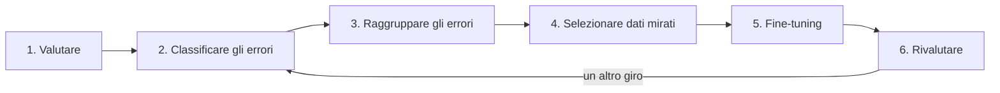

Negli articoli precedenti abbiamo visto come si [misura un modello](https://bigghis.github.io/posts/POST-TRAINING-EVAL-METRICHE/), come si [valuta un modello addestrato con il RL](https://bigghis.github.io/posts/POST-TRAINING-EVAL-RL-RED-TEAMING/) e come si [analizzano i suoi errori](https://bigghis.github.io/posts/POST-TRAINING-ERROR-ANALYSIS/). Adesso mettiamo tutto insieme in un caso concreto.

Partiamo da un modello base e da un problema preciso: risolvere i problemi di matematica di [GSM8K](https://huggingface.co/datasets/openai/gsm8k){:target="_blank"}. Invece di fare un fine-tuning su dati presi a caso, lasciamo che siano gli **eval** a decidere su cosa addestrare il modello. Il ciclo è questo:



Ogni passo è accompagnato dal codice. Il codice completo è in un notebook che si può eseguire in due modi: in modalità `demo`, su CPU e senza scaricare nessun LLM, con risposte del modello simulate ma tutta l'analisi reale; oppure in modalità `hf`, con un modello vero e un fine-tuning vero, su una GPU.

[assets/notebooks/post-training-eval-error-analysis.ipynb](/assets/notebooks/post-training-eval-error-analysis.ipynb)

[](https://mybinder.org/v2/gh/Bigghis/bigghis.github.io/main?labpath=assets%2Fnotebooks%2Fpost-training-eval-error-analysis.ipynb){:target="_blank"} [](https://colab.research.google.com/github/Bigghis/bigghis.github.io/blob/main/assets/notebooks/post-training-eval-error-analysis.ipynb){:target="_blank"}

In fondo all'articolo c'è una **scheda operativa** che riassume il procedimento in una forma pensata per essere riapplicata ad altri problemi.

### Passo 0: separare chi decide da chi misura

Prima di valutare qualunque cosa bisogna decidere **su quali dati**. È una scelta che sembra banale e che invece decide se i risultati finali saranno credibili  o meno.

In questo ciclo gli eval hanno due ruoli diversi. Da una parte servono a **decidere**: guardiamo gli errori del modello e scegliamo i dati di training in base a quegli errori. Dall'altra servono a **misurare** se il modello è migliorato. Se usassimo le stesse domande per entrambe le cose, il miglioramento misurato sarebbe gonfiato: avremmo scelto i dati di training proprio per correggere quelle domande. È una forma sottile di [leakage](https://bigghis.github.io/posts/POST-TRAINING-DATI-TOKEN/#leakage-quando-gli-split-non-sono-davvero-separati), che si potrebbe chiamare "insegnare per il test".

La soluzione è dividere il test set di GSM8K in due parti:

- il **dev set**, su cui facciamo l'error analysis e da cui partiamo per scegliere i dati;
- l'**holdout**, che non guardiamo mai per prendere decisioni e usiamo solo alla fine, per misurare.

```python
from datasets import load_dataset

gsm8k = load_dataset("openai/gsm8k", "main")
train = gsm8k["train"]                       # ~7.500 problemi: la "miniera" dei dati di training
test = gsm8k["test"].shuffle(seed=42)        # ~1.300 problemi

dev_set = test.select(range(300))            # per decidere
holdout_set = test.select(range(300, 600))   # per misurare
```

Il train di GSM8K resta separato: è il bacino da cui pescheremo gli esempi per il fine-tuning.

### Passo 1: valutare il modello

#### Il verifier

Su GSM8K la correttezza si può verificare con una funzione. Nelle soluzioni del dataset la risposta finale segue il marcatore `####`:

```text
Allen's current age is 11/18*162 = 99
If Allen is currently 99 years old, in 10 years he will be 99+10 = 109 years old
#### 109
```

Il modello, invece, non sempre usa quel formato. Un modello base tende a scrivere *"The answer is 94."*, oppure a finire con un calcolo senza dichiarare il risultato. L'estrazione deve quindi essere robusta, con una serie di tentativi in ordine di affidabilità:

```python
import re

NUM = r"-?\d[\d,]*(?:\.\d+)?"

def to_float(s):
    try:
        return float(s.replace(",", "").rstrip("."))
    except (ValueError, AttributeError):
        return None

def extract_gold(answer):
    """Risposta corretta di GSM8K: il numero dopo ####."""
    return to_float(answer.split("####")[-1].strip())

def extract_prediction(text):
    """Risposta del modello: ####, poi 'the answer is', poi l'ultimo numero."""
    m = re.search(r"####\s*\$?\s*(" + NUM + ")", text)
    if m:
        return to_float(m.group(1))
    m = re.search(r"answer is\s*:?\s*\$?\s*(" + NUM + ")", text, re.IGNORECASE)
    if m:
        return to_float(m.group(1))
    numbers = re.findall(NUM, text)
    return to_float(numbers[-1]) if numbers else None

def is_correct(pred, gold):
    return pred is not None and gold is not None and abs(pred - gold) < 1e-3
```

Il confronto usa una tolleranza (`1e-3`) invece dell'uguaglianza esatta, perché i numeri sono in virgola mobile: `99.0` e `99.00000001` devono contare come la stessa risposta.

#### Il prompt e la generazione

Il prompt ha un formato fisso, `Question: ...\nAnswer:`. È importante che sia **identico** a quello che useremo nel fine-tuning: se il modello impara a rispondere dopo `Answer:`, deve trovare `Answer:` anche in valutazione.

La generazione è **greedy** (`do_sample=False`), cioè deterministica: rilanciando la valutazione si ottengono le stesse risposte, e le differenze tra prima e dopo il fine-tuning dipendono dal modello, non dal caso.

```python
def build_prompt(question):
    return f"Question: {question}\nAnswer:"

def clean_response(text):
    """Un modello base, finita la risposta, tende a inventare la domanda successiva: la tagliamo."""
    for stop in ("\nQuestion:", "[Question]", "\n\n\n"):
        text = text.split(stop)[0]
    return text.strip()

def generate_responses(model, tokenizer, questions, batch_size=16, max_new_tokens=320):
    tokenizer.padding_side = "left"          # per generare, il padding va a sinistra
    responses = []
    for i in range(0, len(questions), batch_size):
        prompts = [build_prompt(q) for q in questions[i:i + batch_size]]
        enc = tokenizer(prompts, return_tensors="pt", padding=True).to(model.device)
        out = model.generate(**enc, max_new_tokens=max_new_tokens, do_sample=False,
                             pad_token_id=tokenizer.pad_token_id)
        new_tokens = out[:, enc["input_ids"].shape[1]:]
        responses += [clean_response(t) for t in tokenizer.batch_decode(new_tokens, skip_special_tokens=True)]
    return responses
```

`clean_response` risolve un problema tipico dei modelli base. Non sanno quando fermarsi: dopo aver risposto continuano a scrivere, inventando un nuovo problema e la sua soluzione (*"The answer is 94. [Question] A certain school has 1000 students..."*). Senza tagliare, l'ultimo numero estratto sarebbe quello del problema inventato.

Il padding a sinistra serve perché il modello genera continuando dall'ultimo token: se il padding fosse a destra, per le domande più corte il modello dovrebbe continuare dopo una serie di token vuoti (lo avevamo visto parlando di [batching e padding](https://bigghis.github.io/posts/POST-TRAINING-DATI-TOKEN/#batching-e-padding)).

#### La funzione di valutazione

`evaluate_model` mette insieme i pezzi e restituisce un dizionario con tutto ciò che servirà dopo: domande, risposte, numeri estratti ed esito per ogni domanda.

```python
def evaluate_model(dataset, name):
    questions = [ex["question"] for ex in dataset]
    golds = [extract_gold(ex["answer"]) for ex in dataset]
    responses = generate_responses(model, tokenizer, questions)
    preds = [extract_prediction(r) for r in responses]
    correct = [is_correct(p, g) for p, g in zip(preds, golds)]
    return {"name": name, "questions": questions, "golds": golds, "responses": responses,
            "predictions": preds, "correct": correct, "accuracy": sum(correct) / len(correct)}

dev_before = evaluate_model(dev_set, "dev, prima")
holdout_before = evaluate_model(holdout_set, "holdout, prima")
```

Conviene salvare i risultati su file (nel notebook in `lab_results/*.json`). Generare le risposte è la parte più lenta del ciclo, e avere le risposte salvate permette di rifare l'analisi senza rigenerarle.

L'accuratezza di partenza è il **punto di riferimento** per tutto il resto. Nell'esecuzione simulata del notebook è del 55% sul dev set: 134 errori su 300 domande da analizzare.

### Passo 2: classificare gli errori

Un'accuratezza del 55% dice poco. Il passo successivo è capire **che tipo** di errori fa il modello, assegnando ogni errore a una categoria:

```python
ERROR_CATEGORIES = [
    "calculation_error",    # errori di calcolo
    "reasoning_error",      # errori di ragionamento
    "incomplete_solution",  # risposta parziale o non finita
    "format_error",         # risposta nel formato sbagliato
    "other",                # altro
]
```

#### Con un LLM come giudice

Il modo più preciso è far classificare ogni errore a un LLM, come avevamo visto [nell'articolo sull'error analysis](https://bigghis.github.io/posts/POST-TRAINING-ERROR-ANALYSIS/#con-un-llm). Ci sono due errori facili da commettere.

Il primo riguarda il **prompt**. Se al giudice si danno solo la domanda, la risposta corretta e il numero predetto, il giudice non ha nessun modo di sapere se il modello ha sbagliato un calcolo o un ragionamento: vede solo due numeri diversi. Bisogna includere i **passaggi** della risposta del modello.

```python
def classify_by_llm(question, gold, response, pred):
    prompt = f"""Analyze this math error and categorize it.

PROBLEM: {question}
CORRECT ANSWER: {gold}
MODEL SOLUTION: {response[-1500:]}
PREDICTED ANSWER: {pred}

Choose ONE category: {', '.join(ERROR_CATEGORIES)}
Respond with just the category name."""
    out = judge([{"role": "user", "content": prompt}], max_new_tokens=10, do_sample=False)
    return parse_category(out[0]["generated_text"][-1]["content"])
```

Il secondo riguarda l'**interpretazione della risposta** del giudice. Un LLM non sempre risponde con il nome esatto: può scrivere *"reasoning error"* con lo spazio, oppure *"This is a reasoning_error."*. Una soluzione che sembra ragionevole è cercare le parole della categoria nella risposta:

```python
# versione ingenua: da NON usare
for cat in ERROR_CATEGORIES:
    if any(word in output for word in cat.split("_")):
        return cat
```

Ma la parola `error` compare in quattro categorie su cinque. Se il giudice risponde *"reasoning error"*, il primo controllo è su `calculation_error`, la parola `error` è presente, e l'errore viene classificato come errore di calcolo. Tutta la distribuzione delle categorie risulta spostata verso la prima della lista, e le decisioni prese su quella distribuzione sono sbagliate. La versione corretta cerca il nome intero della categoria:

```python
def parse_category(text):
    text = text.strip().lower()
    for category in ERROR_CATEGORIES:
        if category in text or category.replace("_", " ") in text:
            return category
    return "other"
```

> **Controllare il giudice.** Un giudice LLM è a sua volta un modello che sbaglia. Prima di fidarsi delle sue categorie conviene classificarne a mano una ventina e confrontarle con le sue. Se l'accordo è basso, si migliora il prompt o si cambia modello giudice.
{: .prompt-warning }

#### Con delle regole

Quando non si ha a disposizione un giudice, o per avere un primo risultato in fretta, si possono usare regole semplici basate sulla forma della risposta:

```python
def classify_by_rules(question, gold, response, pred):
    has_marker = "####" in response
    marker_number = re.search(r"####\s*\$?\s*" + NUM, response)
    if pred is None or (has_marker and not marker_number):
        return "format_error"           # nessun numero, o #### senza numero
    if not has_marker and not re.search(r"answer is", response, re.IGNORECASE):
        return "incomplete_solution"    # non dichiara mai un risultato finale
    if abs(pred - gold) / max(abs(gold), 1) <= 0.25:
        return "calculation_error"      # risultato vicino: probabile errore di calcolo
    return "reasoning_error"            # risultato lontano: probabile errore di ragionamento
```

Le regole sono grossolane: un risultato vicino a quello giusto può nascere anche da un ragionamento sbagliato. Ma sono veloci, deterministiche e trasparenti, e spesso bastano per una prima distribuzione. Nell'esecuzione simulata del notebook danno questo risultato:

| Categoria | Errori | Percentuale |
|:---|:---|:---|
| calculation_error | 52 | 38,8% |
| reasoning_error | 50 | 37,3% |
| incomplete_solution | 19 | 14,2% |
| format_error | 13 | 9,7% |

### Passo 3: raggruppare gli errori

Le categorie dicono **come** sbaglia il modello. Il clustering dice **su cosa**: su quali argomenti si concentrano gli errori. Usiamo embedding e k-means, come visto [nell'articolo sull'error analysis](https://bigghis.github.io/posts/POST-TRAINING-ERROR-ANALYSIS/#con-gli-embedding-e-il-k-means), scegliendo il numero di gruppi con il silhouette score:

```python
from sentence_transformers import SentenceTransformer
from sklearn.cluster import KMeans
from sklearn.metrics import silhouette_score

st_model = SentenceTransformer("sentence-transformers/all-MiniLM-L6-v2")
embed = lambda texts: st_model.encode(list(texts), normalize_embeddings=True)

error_embeddings = embed([e["question"] for e in dev_errors])

scores = {}
for k in range(2, 9):
    labels = KMeans(n_clusters=k, random_state=42, n_init=10).fit_predict(error_embeddings)
    scores[k] = silhouette_score(error_embeddings, labels)
best_k = max(scores, key=scores.get)

cluster_labels = KMeans(n_clusters=best_k, random_state=42, n_init=10).fit_predict(error_embeddings)
```

Gli embedding sono **normalizzati** (`normalize_embeddings=True`): in questo modo il prodotto scalare tra due embedding è direttamente la loro similarità del coseno, e lo sfrutteremo nel passo successivo.

Poi si incrociano gruppi e categorie, e si leggono alcuni esempi per gruppo:

```python
import pandas as pd

df = pd.DataFrame({"cluster": cluster_labels, "category": [e["category"] for e in dev_errors],
                   "question": [e["question"] for e in dev_errors]})
print(pd.crosstab(df["cluster"], df["category"], margins=True))

for cluster_id, group in df.groupby("cluster"):
    print(f"\nGruppo {cluster_id} ({len(group)} errori)")
    for q in group["question"].head(3):
        print("  -", q[:110])
```

Con testi brevi e simili tra loro, come i problemi di GSM8K, i silhouette score sono di solito bassi (intorno a 0,05): i gruppi non sono nettamente separati, perché tutti i problemi parlano di quantità, prezzi e persone. Non è un errore. Il clustering resta utile per **leggere** gli errori in modo ordinato, ma non va trattato come una verità: i gruppi sono un aiuto per chi analizza, e vanno sempre controllati guardando gli esempi.

### Passo 4: selezionare i dati di training mirati

Questo è il cuore della tecnica. Invece di fare fine-tuning su esempi presi a caso, cerchiamo nel train di GSM8K gli esempi **più simili alle domande che il modello ha sbagliato**, categoria per categoria. L'idea è che, esercitandosi su problemi simili a quelli che sbaglia, il modello migliori proprio dove serve.

#### L'idea in breve

1. Si calcolano gli embedding di tutte le domande del train.
2. Si raggruppano gli errori del dev set per categoria.
3. Per ogni errore si calcola la similarità con tutte le domande del train e si prendono le più vicine.
4. Per ogni categoria si tengono al massimo un certo numero di esempi (il **budget**), i più simili.

#### Un bug sottile

Il modo più naturale di dividere il budget è assegnare a ogni errore lo stesso numero di esempi: `budget // numero_di_errori`. Con 60 esempi di budget e 13 errori di formato, ogni errore prende 4 esempi. Ma con 52 errori di calcolo, `60 // 52` fa **1**, e con 70 errori farebbe **0**.

E con 0 succede qualcosa di inaspettato. Per prendere gli ultimi $$k$$ elementi di un array ordinato si scrive di solito `np.argsort(sims)[-k:]`. Con $$k = 0$$ diventa `[-0:]`, cioè `[0:]`: **l'intero array**. La categoria con più errori, quella che dovrebbe ricevere gli esempi più mirati, finisce per selezionare tutti i 7.500 esempi del train. Il fine-tuning "mirato" diventa un fine-tuning su tutto il dataset, e nessun messaggio di errore lo segnala.

La correzione è garantire **almeno un esempio per errore**, e applicare il budget alla fine, tenendo gli esempi più simili:

```python
per_error = max(1, math.ceil(budget_per_category / len(questions)))   # mai zero
```

È un buon esempio di perché, dopo ogni passo, conviene stampare i numeri e chiedersi se sono plausibili: *"ho selezionato 7.500 esempi per una categoria con un budget di 60"* è un segnale evidente, se lo si guarda.

#### Non far trapelare il test

C'è un altro rischio. Il train e il test di GSM8K sono separati, ma possono contenere problemi quasi identici. Se tra gli esempi selezionati finisce un quasi-duplicato di una domanda di holdout, il modello "vede" quella domanda durante il training, e il risultato finale è gonfiato. Per questo si escludono gli esempi di train troppo simili (similarità sopra 0,95) a qualunque domanda di dev o holdout, lo stesso principio dei [near-duplicate](https://bigghis.github.io/posts/POST-TRAINING-DATI-TOKEN/#near-duplicate-e-minhash).

#### La funzione completa

```python
import math
from collections import defaultdict
import numpy as np

def select_targeted_examples(errors, train, embed, budget_per_category, eval_questions,
                             max_sim_to_eval=0.95):
    train_questions = list(train["question"])
    train_emb = embed(train_questions)

    # 1. escludo i quasi-duplicati delle domande di valutazione
    eval_emb = embed(eval_questions)
    allowed = (train_emb @ eval_emb.T).max(axis=1) < max_sim_to_eval

    by_category = defaultdict(list)
    for e in errors:
        by_category[e["category"]].append(e["question"])

    selected = {}                                   # indice nel train -> (similarità, categoria)
    for category, questions in by_category.items():
        sims = embed(questions) @ train_emb.T       # similarità coseno (errori x train)
        sims[:, ~allowed] = -1.0
        per_error = max(1, math.ceil(budget_per_category / len(questions)))
        candidates = {}
        for row in sims:                            # i più vicini a ogni errore
            for j in np.argsort(row)[::-1][:per_error]:
                candidates[int(j)] = max(candidates.get(int(j), -1.0), float(row[j]))
        best = sorted(candidates.items(), key=lambda kv: -kv[1])[:budget_per_category]
        for j, s in best:                           # un esempio scelto da più categorie conta una volta
            if j not in selected or s > selected[j][0]:
                selected[j] = (s, category)

    return [{"question": train[j]["question"], "answer": train[j]["answer"],
             "category": cat, "similarity": s} for j, (s, cat) in selected.items()]

targeted = select_targeted_examples(dev_errors, train, embed, budget_per_category=60,
                                    eval_questions=list(dev_set["question"]) + list(holdout_set["question"]))
```

Nell'esecuzione del notebook la selezione produce 229 esempi, circa 60 per categoria, con una similarità media di 0,7 con le domande sbagliate.

#### Il confronto onesto: una selezione casuale

Se dopo il fine-tuning il modello migliora, come facciamo a sapere che il merito è della selezione mirata? Forse qualunque fine-tuning su 229 esempi di GSM8K avrebbe dato lo stesso risultato, semplicemente perché il modello impara il formato `####`.

L'unico modo di saperlo è un **gruppo di controllo**: un secondo fine-tuning, identico, su 229 esempi presi **a caso** dal train.

```python
rng = random.Random(42)
random_baseline = [train[j] for j in rng.sample(range(len(train)), len(targeted))]
```

Se i dati mirati non battono quelli casuali sull'holdout, la selezione per similarità non sta aggiungendo nulla, e conviene cercare altrove.

### Passo 5: il fine-tuning

Il fine-tuning in sé è un normale fine-tuning supervisionato, ma con tre scelte che fanno la differenza.

#### La loss solo sulla risposta

Ogni esempio è formato da domanda e soluzione, con lo stesso formato del prompt di valutazione. La loss va calcolata **solo sui token della soluzione**: vogliamo che il modello impari a rispondere, non a scrivere domande. Si ottiene mettendo a `-100` le etichette dei token della domanda, il valore che la cross-entropy di PyTorch ignora (è la [loss mask](https://bigghis.github.io/posts/POST-TRAINING-FINE-TUNING/#loss-mask-imparare-dalle-risposte-non-dalle-domande)):

```python
from datasets import Dataset

def strip_calculator(answer):
    """Toglie le annotazioni <<48/2=24>> delle soluzioni di GSM8K."""
    return re.sub(r"<<[^>]*>>", "", answer)

def build_sft_dataset(examples, tokenizer, max_length=512):
    rows = []
    for ex in examples:
        prompt_ids = tokenizer(build_prompt(ex["question"]) + " ", add_special_tokens=False)["input_ids"]
        answer_ids = tokenizer(strip_calculator(ex["answer"]) + tokenizer.eos_token,
                               add_special_tokens=False)["input_ids"]
        input_ids = (prompt_ids + answer_ids)[:max_length]
        labels = ([-100] * len(prompt_ids) + answer_ids)[:max_length]      # loss mask
        rows.append({"input_ids": input_ids, "attention_mask": [1] * len(input_ids), "labels": labels})
    return Dataset.from_list(rows)
```

Il token di fine sequenza (`eos_token`) alla fine della risposta insegna al modello **quando fermarsi**. È proprio ciò che manca al modello base, che dopo la risposta continua a inventare nuovi problemi.

Un approccio più semplice, ma sbagliato, è copiare gli `input_ids` nelle etichette (`labels = input_ids`) e lasciare che il modello impari su tutto il testo. Funziona, ma una parte dell'addestramento va sprecata a imparare a scrivere domande.

#### LoRA e un learning rate adatto

Per un modello da 7 miliardi di parametri un fine-tuning completo richiede decine di GB di memoria solo per gradienti e stati dell'optimizer. Con [LoRA](https://bigghis.github.io/posts/POST-TRAINING-FINE-TUNING/#lora-fine-tuning-con-una-frazione-dei-parametri) si addestra una piccola frazione dei parametri: con Qwen2.5-0.5B, LoRA di rango 16 su tutti i layer lineari addestra circa 8,8 milioni di parametri su 500 milioni (l'1,7%).

```python
from peft import LoraConfig, get_peft_model
from transformers import DataCollatorForSeq2Seq, Trainer, TrainingArguments

peft_model = get_peft_model(base_model, LoraConfig(
    r=16, lora_alpha=32, lora_dropout=0.05, target_modules="all-linear", task_type="CAUSAL_LM"))

args = TrainingArguments(
    output_dir="lab_results/lora_targeted",
    num_train_epochs=2,
    per_device_train_batch_size=4,
    gradient_accumulation_steps=4,     # batch effettivo di 16 esempi
    learning_rate=2e-4,                # tipico per LoRA
    lr_scheduler_type="cosine",
    warmup_steps=2,
    logging_steps=5,
    eval_strategy="steps",
    eval_steps=10,
    save_strategy="no",
    report_to=[],
)

tokenizer.padding_side = "right"       # per il training il padding va a destra
trainer = Trainer(model=peft_model, args=args, train_dataset=train_ds, eval_dataset=val_ds,
                  data_collator=DataCollatorForSeq2Seq(tokenizer, label_pad_token_id=-100, padding=True))
trainer.train()
```

Il [learning rate](https://bigghis.github.io/posts/POST-TRAINING-FINE-TUNING/#learning-rate) merita attenzione. Con LoRA valori intorno a `2e-4` sono tipici. Con un fine-tuning completo si usano valori molto più bassi, intorno a `1e-5`. Ma scendere troppo è un errore altrettanto grave che salire troppo: con un learning rate di `1e-8`, per esempio, in poche centinaia di step i pesi praticamente non cambiano. Il modello "addestrato" è quasi identico all'originale, e qualunque differenza di accuratezza misurata dopo è solo rumore, che si rischia di scambiare per un effetto del fine-tuning.

Durante il training si guardano le curve di training e validation loss, come visto [nell'articolo sul fine-tuning](https://bigghis.github.io/posts/POST-TRAINING-FINE-TUNING/#monitorare-il-training). La validation si ricava dagli esempi selezionati (un 10%), mai dal dev o dall'holdout.

### Passo 6: rivalutare e capire se il miglioramento è reale

Si rivaluta il modello su dev e holdout, con la stessa funzione e lo stesso prompt di prima. Il numero che conta di più è quello sull'**holdout**, l'unico su cui non abbiamo preso nessuna decisione.

#### La matrice di transizione

L'accuratezza complessiva nasconde molte informazioni. Due modelli con la stessa accuratezza possono rispondere bene a domande diverse. Per questo si confronta l'esito di **ogni domanda** prima e dopo:

| | Dopo: corretta | Dopo: sbagliata |
|:---|:---|:---|
| **Prima: corretta** | ancora corrette | **nuove sbagliate** |
| **Prima: sbagliata** | **nuove corrette** | ancora sbagliate |

Le domande che contano sono quelle che hanno **cambiato esito**. Le nuove corrette sono il guadagno del fine-tuning, le nuove sbagliate il suo costo: un fine-tuning su un tipo di problema può peggiorare il modello su altri, anche se l'accuratezza complessiva sale.

#### Il test di McNemar

Supponiamo che sull'holdout ci siano 32 nuove corrette e 7 nuove sbagliate. Il miglioramento è reale o potrebbe essere un caso?

Il **test di McNemar** risponde con un ragionamento semplice. Se il fine-tuning non avesse alcun effetto, le domande che cambiano esito lo farebbero a caso, e sarebbe come lanciare una moneta: metà diventerebbero corrette e metà sbagliate. Il test calcola quanto è probabile ottenere uno squilibrio come 32 contro 7 lanciando una moneta 39 volte. Se questa probabilità (il **p-value**) è molto piccola, per esempio sotto 0,05, il miglioramento difficilmente è dovuto al caso.

In codice è un test binomiale sulle sole domande che hanno cambiato esito:

```python
from scipy.stats import binomtest

def mcnemar_p(correct_before, correct_after):
    fixed = sum(1 for b, a in zip(correct_before, correct_after) if not b and a)    # nuove corrette
    broken = sum(1 for b, a in zip(correct_before, correct_after) if b and not a)   # nuove sbagliate
    return binomtest(fixed, fixed + broken, 0.5).pvalue if fixed + broken else 1.0
```

Accanto al p-value si calcola l'intervallo di confidenza della differenza di accuratezza con il [bootstrap a coppie](https://bigghis.github.io/posts/POST-TRAINING-ERROR-ANALYSIS/#affidabili), che dice non solo se il miglioramento è reale ma **quanto è grande**.

Nell'esecuzione simulata del notebook il risultato è questo:

```text
DEV:     0.553 -> 0.647 (+0.093, IC95% [+0.053, +0.137])
  nuove corrette 35, nuove sbagliate 7, McNemar p = 0.0000

HOLDOUT: 0.547 -> 0.630 (+0.083, IC95% [+0.043, +0.123])
  nuove corrette 32, nuove sbagliate 7, McNemar p = 0.0001
```

Il miglioramento sull'holdout è un po' più piccolo che sul dev, ed è normale: i dati di training sono stati scelti guardando gli errori del dev. Se la differenza tra dev e holdout fosse molto grande, sarebbe un segnale che il fine-tuning ha imparato le domande del dev più che il tipo di problema.

> **Con pochi esempi non si conclude nulla.** Con 20 domande, anche un fine-tuning efficace può dare 1 nuova corretta e 1 nuova sbagliata, con un p-value di 1. Prima di trarre conclusioni bisogna avere abbastanza domande che cambiano esito: con 300 domande per l'holdout e un'accuratezza intorno al 55%, l'incertezza è ancora di circa ±6 punti.
{: .prompt-warning }

### Passo 7: un altro giro

Il ciclo non finisce con il primo fine-tuning. Si rifà l'error analysis sugli errori **rimasti** e si confronta la distribuzione delle categorie:

| Categoria | Prima | Dopo | Variazione |
|:---|:---|:---|:---|
| calculation_error | 52 | 40 | −12 |
| reasoning_error | 50 | 34 | −16 |
| incomplete_solution | 19 | 16 | −3 |
| format_error | 13 | 9 | −4 |

_Valori dell'esecuzione simulata._

Le categorie che scendono poco sono i candidati per il prossimo giro. Se gli errori incompleti non diminuiscono, per esempio, forse il problema non è nei dati ma nel limite di token della generazione, e la correzione è un'altra. Ogni giro produce nuove ipotesi, da verificare con esperimenti piccoli, e quando una correzione funziona si prova su scala maggiore: più errori analizzati, un budget più grande, un modello più grande.

### Scheda operativa

Questa sezione riassume il procedimento in una forma compatta, pensata per riapplicarlo ad altri problemi.

#### Cosa serve

| Ingrediente | Nel caso di GSM8K | In generale |
|:---|:---|:---|
| Modello da migliorare | Qwen2.5-0.5B (o DeepSeek-Math-7B-base) | Un modello base o instruct |
| Eval con risposta verificabile | test di GSM8K, risposta dopo `####` | Domande con un verifier: numero, JSON, test di unità, etichetta |
| Bacino di dati di training | train di GSM8K (~7.500 esempi) | Esempi `{input, target}` dello stesso dominio |
| Verifier | `extract_prediction` + tolleranza `1e-3` | Funzione deterministica che dice corretto/sbagliato |
| Categorie di errore | 5 categorie (calcolo, ragionamento, ...) | 4–8 categorie specifiche del dominio, più `other` |
| Modello di embedding | `all-MiniLM-L6-v2` | Qualunque modello di embedding, con vettori normalizzati |

#### I passi

| Passo | Input | Output (artefatto) | Controllo da fare |
|:---|:---|:---|:---|
| 0. Split | test set | dev set, holdout | Dev e holdout disgiunti; holdout mai usato per decidere |
| 1. Valutazione | modello, dev, holdout | `dev_before.json`, `holdout_before.json` | Leggere 10 risposte: il verifier estrae il numero giusto? |
| 2. Classificazione | errori del dev | `dev_errors.json` con la categoria | Classificare 20 errori a mano e confrontare con il giudice |
| 3. Clustering | embedding degli errori | gruppo per ogni errore, tabella gruppi × categorie | Leggere 3–5 esempi per gruppo |
| 4. Selezione | errori per categoria, train | `targeted_examples.json` + selezione casuale | Numero di esempi per categoria ≈ budget; nessun quasi-duplicato del test |
| 5. Fine-tuning | esempi selezionati | modello con adapter LoRA | Validation loss che scende; loss mask attiva; learning rate sensato |
| 6. Rivalutazione | modello nuovo, dev, holdout | `report.json` | Holdout: differenza, IC95%, McNemar; confronto con la selezione casuale |
| 7. Nuovo giro | errori rimasti | nuova distribuzione delle categorie | Quali categorie non scendono? |

#### Parametri di partenza

| Parametro | Valore | Note |
|:---|:---|:---|
| Dimensione di dev e holdout | 300 + 300 | Sotto le 200 domande le differenze di pochi punti non sono affidabili |
| Generazione | greedy, `max_new_tokens` 320 | Deterministica; troppi pochi token producono errori "incompleti" artificiali |
| Budget per categoria | 60 esempi | Almeno un esempio per errore |
| Soglia per i quasi-duplicati | similarità 0,95 | Esclude dal train gli esempi troppo simili al test |
| LoRA | rango 16, alpha 32, `all-linear` | |
| Learning rate | `2e-4` (LoRA), `~1e-5` (full) | Mai valori come `1e-8`: il modello non cambierebbe |
| Epoche | 2 | Con pochi esempi, più epoche portano presto all'overfitting |

#### Criteri di decisione

- **Il miglioramento è reale** se sull'holdout l'intervallo di confidenza della differenza non contiene lo zero e il p-value di McNemar è sotto 0,05.
- **La selezione mirata serve** se batte la selezione casuale della stessa dimensione sull'holdout. Altrimenti il guadagno viene dal fine-tuning in generale (per esempio dal formato), non dalla selezione.
- **C'è overfitting sul dev** se il miglioramento sul dev è molto più grande di quello sull'holdout.
- **Il fine-tuning ha un costo** se le nuove sbagliate sono molte: guardare su quali domande e se appartengono a una categoria precisa.
- **Fermarsi** quando l'accuratezza smette di salire tra un giro e l'altro, o quando le categorie rimaste richiedono un intervento diverso (più dati di un altro tipo, un modello più grande, il RL).

#### Errori comuni

| Errore | Effetto | Come accorgersene |
|:---|:---|:---|
| Stesse domande per decidere e misurare | Miglioramento gonfiato | Manca un holdout |
| Prompt diverso tra valutazione e training | Il modello non riconosce il formato | Confrontare le due funzioni che costruiscono il prompt |
| Risposte non tagliate dopo la fine | Si estrae il numero di un problema inventato | Leggere le risposte complete |
| Giudice che non vede i passaggi | Categorie casuali | Il prompt del giudice contiene solo i numeri |
| Parsing della categoria per parole | Quasi tutto finisce nella prima categoria | Distribuzione sbilanciata verso la prima voce della lista |
| Budget per errore uguale a zero | Selezionato tutto il train | Numero di esempi selezionati molto più alto del budget |
| Quasi-duplicati del test nel training | Risultato gonfiato | Similarità massima tra train selezionato e test |
| Loss su domanda e risposta | Training meno efficace | Etichette uguali agli `input_ids` |
| Learning rate troppo basso | Nessun cambiamento reale, solo rumore | Loss che non scende; quasi nessuna domanda cambia esito |
| Nessun test statistico | Si scambia il rumore per un miglioramento | Mancano intervallo di confidenza e McNemar |

#### Adattare il ciclo ad altri problemi

Il procedimento non dipende dalla matematica. Cambiano tre cose: il **verifier**, le **categorie di errore** e il **bacino di dati**.

| Problema | Verifier | Categorie di errore possibili |
|:---|:---|:---|
| Estrazione di dati in JSON (es. da fatture) | JSON valido, schema rispettato, campi uguali al riferimento | JSON non valido, campo mancante, campo sbagliato, formato data/importo, allucinazione |
| Classificazione di testi | Etichetta uguale a quella attesa | Confusione tra due classi specifiche, testo ambiguo, testo fuori dominio |
| Generazione di codice | Test di unità | Errore di sintassi, logica sbagliata, caso limite, API sbagliata |
| Domande su documenti (RAG) | Risposta contenuta nel documento, citazione corretta | Ignora il contesto, parte sbagliata del contesto, allucinazione, rifiuto non necessario |

In tutti i casi il ciclo resta lo stesso: separare chi decide da chi misura, verificare in modo automatico, classificare e raggruppare gli errori, selezionare dati simili agli errori, addestrare con cura e misurare con la statistica.

### Cosa portare a casa

Gli eval non servono solo a dare un voto al modello. In questo ciclo sono loro a decidere **quali dati** usare per addestrarlo: gli errori sul dev set, classificati e raggruppati, diventano una ricerca per similarità nel bacino di dati di training, e il fine-tuning si concentra su ciò che il modello non sa ancora fare.

Perché il ciclo funzioni servono alcune attenzioni che sembrano dettagli ma decidono il risultato: un holdout che non viene mai usato per decidere, un verifier robusto, un giudice che vede i passaggi e una classificazione interpretata correttamente, una selezione che non si trasforma per errore in tutto il dataset, una loss calcolata solo sulle risposte, un learning rate sensato. E alla fine, una verifica statistica e un confronto con una selezione casuale, per essere sicuri che il miglioramento sia reale e che venga davvero dalla selezione mirata.

Il risultato di un giro è il punto di partenza del successivo. È il senso degli eval come stella polare: a ogni iterazione indicano dove spostare il lavoro.

Nel [prossimo articolo](https://bigghis.github.io/posts/POST-TRAINING-SCEGLIERE-DATI/) allarghiamo lo sguardo: una volta che gli eval dicono *dove* intervenire, come si decide *quanti* dati servono, in che forma, e come si mettono insieme fine-tuning e RL.
