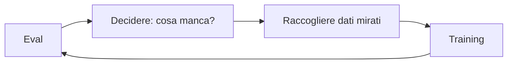

Alla fine dell'[articolo su PPO e GRPO](https://bigghis.github.io/posts/POST-TRAINING-PPO-GRPO/) eravamo arrivati a una conclusione: il modello impara a massimizzare qualunque segnale gli si dia, e l'unico modo per sapere se sta davvero migliorando è valutarlo su dati che non ha mai visto.  
In questo articolo vediamo cosa sono gli **eval** (le valutazioni) nel post-training, perché sono loro a decidere la direzione dell'addestramento e quali metriche si usano per misurare un modello, dalla semplice correttezza fino alla calibrazione, all'efficienza e ai benchmark sul lavoro reale.

### Gli eval non sono un esame finale

C'è un'idea diffusa, e sbagliata, su come funzionano gli eval. Si raccolgono i dati, si addestra il modello, alla fine si lancia una valutazione che restituisce un punteggio, e il lavoro è finito. In questa visione il training è "il vero lavoro" e gli eval servono solo a scegliere il modello migliore tra quelli addestrati.

Il problema si vede con un esempio. Supponiamo di addestrare un modello a fare calcoli e di valutarlo con queste domande:

| Domanda | Risposta del modello |
|:---|:---|
| 1 + 1 | 2 |
| 2 + 2 | 4 |
| 3 + 1 | 4 |
| 3 + 6 | 9 |

Il punteggio è perfetto, e la conclusione naturale è che il modello funziona e non c'è altro da fare.
Ma potremmo fare un altro test con numeri più grandi, per esempio *"100 + 2"* e *"10000 / 2 "*. Se li aggiungiamo, scopriamo che il modello risponde 4 e 600. Le nostre prime domande e valutazioni non avevano visto questi problemi.


E non basta aggiungere un esempio. Un solo caso di divisione può andare bene per caso, o fallire per un motivo che con la divisione non c'entra nulla. Per capire davvero cosa sa fare il modello, gli eval vanno costruiti con cura, coprendo in modo sistematico le capacità che ci interessano.

#### Un meccanismo di guida

Gli eval, quindi, non vanno posti alla fine del processo, ma all'inizio di ogni iterazione:



Se vogliamo che il modello impari una nuova capacità, per esempio le divisioni, **la prima cosa da fare è aggiungerla agli eval**. Gli eval mostrano dove il modello sbaglia, e questo decide quali dati raccogliere e come modificare il training. Il training lavora su ciò che gli eval hanno messo in evidenza. Poi si valuta di nuovo, e il ciclo ricomincia.

Per il RL vale lo stesso ragionamento. Lì, al posto di un test set, si usa un ambiente di test: una raccolta di compiti che il modello deve svolgere, ciascuno valutato dai grader. Alla fine si guarda il punteggio medio per ogni tipo di compito. Per esempio:

| Tipo di compito | Punteggio medio |
|:---|:---|
| Divisioni difficili (`math_division_hard`) | 0,42 |
| Ordini in formato JSON (`json_schema_orders`) | 0,98 |

Gli ordini in JSON il modello li sa già fare, e insistere lì serve a poco. Le divisioni difficili invece le sbaglia più della metà delle volte, ed è lì che conviene concentrare il prossimo giro di training. **In pratica significa aggiungere all'ambiente più problemi di divisione**, controllare che i grader valutino bene queste risposte e, se servono, fornire al modello gli strumenti o i file di cui ha bisogno per risolverle.

> **Analogia della stella polare.** Per chi naviga di notte, la stella polare è il riferimento che a ogni momento dice da che parte andare. Gli eval hanno lo stesso ruolo. Non certificano che il viaggio è finito, ma indicano in ogni iterazione dove spostare il lavoro.
{: .prompt-info }

### Perché la loss non basta

Nel pre-training si guardano la loss e metriche derivate come la **perplexity** (quanto il modello è "sorpreso" dal testo vero). Funzionano bene, perché l'obiettivo del pre-training è proprio prevedere il prossimo token.

Nel post-training la loss continua a servire, ma solo per capire se il training è **stabile**, come avevamo visto [monitorando training e validation loss](https://bigghis.github.io/posts/POST-TRAINING-FINE-TUNING/#monitorare-il-training). Per l'esperienza dell'utente dice poco o nulla. Una loss che scende indica che il modello si avvicina ai target dei dati, non che risponde meglio alle persone. Nel RL, poi, il reward sale anche quando il modello sta imparando a ingannare il grader.

Per questo nel post-training gli eval sono probabilmente l'investimento più importante. Spesso sono dataset grandi e richiedono molto lavoro di preparazione, ma sono l'unica misura diretta del comportamento che vogliamo ottenere.

### I test set

La forma base di eval è il **test set** (o *eval set*): un insieme di dati **held-out**, cioè tenuti da parte e mai usati in training, che rappresentano il comportamento desiderato. Come dividere i dati senza contaminazioni lo abbiamo visto [nell'articolo su dati e token](https://bigghis.github.io/posts/POST-TRAINING-DATI-TOKEN/#dividere-i-dati-per-potersi-fidare-del-modello).

#### Test set per il fine-tuning

Il test set ha la stessa forma dei dati di fine-tuning, cioè coppie `{input, target output}`. Si dà l'input al modello e si confronta il suo output con il target.

```text
Input:             Ho mal di testa…
Target:            Mi dispiace. Vuoi che ti suggerisca qualche rimedio?
Output del modello: Spero che tu stia meglio presto!
```

L'output del modello non è quello che volevamo: il target offre aiuto concreto, l'output creato no. Quando la risposta è testo libero il confronto non può essere un semplice "uguale o diverso". Serve un grader, che può essere una regola, un [LLM as a judge](https://bigghis.github.io/posts/EVAL-SUMMARY/) o una persona, con criteri chiari su cosa rende una risposta vicina al target.

#### Test set per le preferenze

Per il preference learning il test set ha la forma `{input, output A, output B, preferenza}`, la stessa dei dati usati per [addestrare il reward model](https://bigghis.github.io/posts/POST-TRAINING-RL-REWARD-RLHF/#dalle-classifiche-alle-coppie).

```text
Input:       Ho mal di testa…
Output A:    Hai mal di testa…
Output B:    Spero che tu stia meglio presto!
Preferenza:  B
```

Si fa valutare la coppia al reward model e si controlla se assegna il punteggio più alto alla risposta preferita dalle persone. La metrica più semplice è l'**accuratezza sulle coppie**, cioè la percentuale di coppie in cui il reward model è d'accordo con l'etichetta umana.

### Metriche per le preferenze

Quando le risposte non hanno una soluzione unica, invece di un punteggio assoluto si può misurare quale modello è preferito. Due famiglie di metriche sono molto diffuse.

#### Rating Elo

Il sistema **Elo**, nato per gli scacchi, assegna a ogni modello un punteggio calcolato da tante "partite". In ogni partita due modelli rispondono allo stesso input e un giudice (persona o LLM) sceglie la risposta migliore, oppure dichiara un pareggio.

Il cuore del sistema è il **punteggio atteso**. Se il modello A ha rating $$R_A$$ e il modello B ha rating $$R_B$$, la probabilità che vinca A è:

$$
E_A = \frac{1}{1 + 10^{(R_B - R_A)/400}}
$$

Dopo la partita il rating di A si aggiorna in base alla sorpresa:

$$
R_A' = R_A + K \cdot (S_A - E_A)
$$

dove $$S_A$$ vale 1 se A vince, 0,5 se pareggia e 0 se perde, e $$K$$ regola quanto si muovono i punteggi (per esempio 32).

Un esempio. A ha 1.200 punti e B 1.000. Il punteggio atteso di A è circa 0,76, quindi A è il favorito. Se vince, guadagna solo $$32 \cdot (1 - 0{,}76) \approx 8$$ punti, perché il risultato era previsto. Se perde, ne perde circa 24, perché la sconfitta era inattesa. Dopo molte partite su molti input, i rating si stabilizzano e ordinano i modelli. È l'idea alla base delle classifiche pubbliche come **LMArena (ex Chatbot Arena)**.

#### Accordo tra classifiche

A volte non si confrontano due risposte, ma si ordinano in classifica diverse risposte allo stesso input. Per esempio le persone mettono tre risposte nell'ordine 1, 2, 3, e il reward model le ordina 1, 3, 2. Le **metriche di correlazione tra ranghi** misurano quanto le due classifiche sono d'accordo.

La più intuitiva è il **tau di Kendall**: si considerano tutte le coppie di risposte e si contano quelle ordinate allo stesso modo nelle due classifiche (concordi) e quelle ordinate al contrario (discordi).

$$
\tau = \frac{\text{concordi} - \text{discordi}}{\text{numero di coppie}}
$$

Nell'esempio le coppie sono tre. La 1 viene prima della 2 e prima della 3 in entrambe le classifiche (due coppie concordi), mentre 2 e 3 sono invertite (una discorde). Quindi $$\tau = (2 - 1)/3 \approx 0{,}33$$. Il valore va da −1 (classifiche opposte) a +1 (classifiche identiche). Un'alternativa molto usata è la **correlazione di Spearman**, che invece delle coppie confronta direttamente le posizioni.

### Quando la correttezza si può verificare

Per matematica, codice o output strutturati la correttezza si controlla con una funzione. Qui gli eval usano gli stessi strumenti dei [verifier dell'RL](https://bigghis.github.io/posts/POST-TRAINING-RL-REWARD-RLHF/#i-verifier): grader deterministici che assegnano punti per criterio.

```text
Input:  Carly ha 8 mele, ne compra 2 e ne vende 5 al fornaio.
        Quante ne ha ora? Rispondi in JSON.
Output: {"expression": "8+2-5=5", "answer": 5}

Grader: risposta corretta +1, formato JSON valido +1  →  punteggio 2
```

Nel RL il punteggio del grader diventa un reward e aggiorna i pesi; negli eval rimane una misura, calcolata su dati che il modello non ha mai visto.

#### pass@k

Un LLM genera le risposte con un po' di casualità: se gli facciamo la stessa domanda più volte, può rispondere in modi diversi, a volte giusti e a volte sbagliati. Il **pass@k** sfrutta proprio questo. Si fanno generare al modello $$k$$ risposte alla stessa domanda, e la domanda conta come risolta se **almeno una** delle $$k$$ risposte è corretta.

| Problema | Risposta 1 | Risposta 2 | Risposta 3 | Risolto con pass@3? |
|:---|:---|:---|:---|:---|
| Mele di Carly | 4 ✗ | 5 ✓ | 5 ✓ | sì |
| Età di Allen | 99 ✗ | 108 ✗ | 109 ✓ | sì |
| Costo del biglietto | 12 ✗ | 15 ✗ | 14 ✗ | no |

Il pass@3 su questi tre problemi è 2 su 3, cioè circa 67%. Il caso $$k = 1$$, cioè una sola risposta per domanda, è la normale accuratezza, e si chiama **pass@1**.

Le due metriche rispondono a domande diverse. Il pass@1 dice **quanto spesso il modello ha ragione al primo colpo**. Il pass@k dice **se il modello è capace di arrivare alla soluzione**, anche se non sempre ci riesce subito. Il pass@k si trova in moltissimi paper, soprattutto sulla generazione di codice.

##### La versione più semplice

L'implementazione diretta segue la definizione. Servono tre cose: una funzione che genera più risposte, un verifier che controlla se una risposta è corretta e un ciclo sui problemi.

Per generare più risposte diverse bisogna attivare il **sampling** con una temperatura maggiore di zero. Con il decoding deterministico (temperatura 0) il modello darebbe sempre la stessa risposta, e il pass@k coinciderebbe con il pass@1.

```python
def genera_risposte(model, tokenizer, domanda, n, temperature=0.8, max_new_tokens=512):
    prompt = f"Question: {domanda}\nAnswer:"
    inputs = tokenizer(prompt, return_tensors="pt").to(model.device)
    outputs = model.generate(
        **inputs,
        do_sample=True,               # attiva la casualità
        temperature=temperature,
        num_return_sequences=n,       # n risposte alla stessa domanda
        max_new_tokens=max_new_tokens,
        pad_token_id=tokenizer.eos_token_id,
    )
    nuovi_token = outputs[:, inputs["input_ids"].shape[1]:]   # tolgo il prompt
    return tokenizer.batch_decode(nuovi_token, skip_special_tokens=True)
```

Il verifier, per un dataset come GSM8K, estrae il numero finale e lo confronta con quello atteso:

```python
import re

def estrai_numero(testo):
    if "####" in testo:                     # formato di GSM8K: "#### 42"
        testo = testo.split("####")[-1]
    numeri = re.findall(r"-?\d+(?:\.\d+)?", testo.replace(",", ""))
    return float(numeri[-1]) if numeri else None

def e_corretta(risposta, atteso):
    pred = estrai_numero(risposta)
    return pred is not None and abs(pred - atteso) < 1e-3
```

A questo punto il pass@k più semplice è una riga: un problema è risolto se `any` delle sue $$k$$ risposte è corretta, e il punteggio finale è la media sui problemi.

```python
def pass_at_k_semplice(model, tokenizer, dataset, k):
    risolti = []
    for esempio in dataset:
        atteso = estrai_numero(esempio["answer"])
        risposte = genera_risposte(model, tokenizer, esempio["question"], n=k)
        risolti.append(any(e_corretta(r, atteso) for r in risposte))
    return sum(risolti) / len(risolti)
```

##### La versione usata nella pratica

La versione semplice funziona, ma ha due difetti.

- **Dipende troppo dalla fortuna.** Ogni problema vale 0 o 1 in base a un solo giro di $$k$$ risposte. Rilanciando la valutazione, lo stesso modello può ottenere un punteggio diverso.
- **Serve un giro di generazione per ogni $$k$$.** Per avere pass@1, pass@5 e pass@10 bisognerebbe generare tre volte.

Nella pratica per ogni problema si generano più risposte di quelle che servono, per esempio $$n = 20$$, e si conta quante sono corrette, $$c$$. Da questi due numeri si ricava il pass@k per qualunque $$k$$ fino a 20, senza generare di nuovo.

Immaginiamo di un sacchetto con dentro 20 risposte, di cui 3 corrette e 17 sbagliate, e ne peschiamo $$k$$ a caso. Il pass@k del problema è la probabilità che tra quelle pescate ce ne sia almeno una corretta, cioè 1 meno la probabilità di pescarle tutte sbagliate. Questo metodo è stato proposto nel paper di Codex ([Chen et al., 2021](https://arxiv.org/abs/2107.03374){:target="_blank"}) e una possibile implementazione può essere questa descritta qui

```python
import numpy as np

def pass_at_k(n, c, k):
    """n risposte generate, c corrette: probabilità che almeno una di k pescate a caso sia corretta."""
    if n - c < k:          # le sbagliate sono meno di k: almeno una corretta la peschiamo per forza
        return 1.0
    prob_tutte_sbagliate = np.prod(1.0 - k / np.arange(n - c + 1, n + 1))
    return 1.0 - prob_tutte_sbagliate

pass_at_k(n=10, c=3, k=1)   # 0.30 -> per k = 1 è semplicemente c / n
pass_at_k(n=10, c=3, k=3)   # 0.71
```

La valutazione completa genera una volta sola e calcola tutti i $$k$$ che servono:

```python
def valuta_pass_at_k(model, tokenizer, dataset, n=20, ks=(1, 5, 10)):
    punteggi = {k: [] for k in ks}
    for esempio in dataset:
        atteso = estrai_numero(esempio["answer"])
        risposte = genera_risposte(model, tokenizer, esempio["question"], n=n)
        c = sum(e_corretta(r, atteso) for r in risposte)
        for k in ks:
            punteggi[k].append(pass_at_k(n, c, k))
    return {f"pass@{k}": np.mean(v) for k, v in punteggi.items()}

# {'pass@1': 0.41, 'pass@5': 0.68, 'pass@10': 0.77}   (valori di esempio)
```

Qualche indicazione pratica:

- $$n$$ deve essere almeno uguale al $$k$$ più grande che si vuole misurare, e conviene che sia più grande (per esempio il doppio), così la stima è più stabile.
- Il costo cresce con $$n$$: 20 risposte per 1.000 problemi sono 20.000 generazioni. Librerie di inferenza veloce come vLLM aiutano molto.
- La temperatura va dichiarata insieme al risultato, perché lo cambia. Una temperatura più alta dà risposte più varie e di solito alza il pass@k con $$k$$ grandi, ma abbassa il pass@1.

##### Leggere i risultati

pass@1 e pass@k possono raccontare storie diverse. Il grafico mostra due modelli simulati.


_Il modello B è molto più affidabile al primo tentativo, ma con molti tentativi il modello A risolve più problemi._

Il modello B risponde bene più spesso al primo colpo. Il modello A sbaglia più spesso, ma prova strade più varie, e con molti tentativi risolve più problemi. Un andamento simile è stato osservato confrontando modelli prima e dopo il RL ([Yue et al., 2025](https://arxiv.org/abs/2504.13837){:target="_blank"}). Il RL alza molto il pass@1, perché insegna al modello a scegliere più spesso le soluzioni che già conosceva, mentre con molti tentativi il modello di partenza a volte risolve più problemi.

Il pass@k è utile anche **prima** di un training con [GRPO](https://bigghis.github.io/posts/POST-TRAINING-PPO-GRPO/#quando-grpo-non-impara-nulla). GRPO genera un gruppo di risposte per ogni prompt e impara solo dai prompt in cui almeno una risposta del gruppo è corretta. Se il gruppo è di 16 risposte, il pass@16 del modello di partenza dice su quanti prompt il RL avrà qualcosa da imparare. Se è vicino a zero, conviene partire da un fine-tuning o da problemi più facili.

> **pass@k non è ciò che vede l'utente.** In un chatbot l'utente riceve una risposta sola, quindi per l'esperienza dell'utente conta il pass@1. Il pass@k è la metrica giusta quando esiste un modo automatico per scegliere la risposta buona tra tante, per esempio i test di unità sul codice, oppure quando si vuole misurare il potenziale di un modello. Una variante intermedia è il **maj@k**: si generano $$k$$ risposte e si tiene quella più frequente (voto a maggioranza), cosa che si può fare anche in produzione, perché non richiede di sapere quale sia la risposta giusta.
{: .prompt-warning }

```python
from collections import Counter

def maj_at_k(risposte, atteso):
    numeri = [estrai_numero(r) for r in risposte if estrai_numero(r) is not None]
    if not numeri:
        return False
    piu_frequente, _ = Counter(numeri).most_common(1)[0]
    return abs(piu_frequente - atteso) < 1e-3
```

### Calibrazione: fidarsi della confidenza del modello

Oltre a sapere se il modello ha ragione, ci interessa sapere **quanto è affidabile la sua confidenza**. Un modello è **calibrato** quando le probabilità che assegna corrispondono alle frequenze reali.

> L'esempio classico è il meteo. Se un previsore dice "80% di probabilità di pioggia", tra tutti i giorni in cui lo dice dovrebbe piovere circa 8 volte su 10. Se piove 5 volte su 10, il previsore funziona male perché è troppo sicuro di sé.
{: .prompt-info }

Per un LLM vale lo stesso. Quando il modello genera una risposta, assegna una probabilità ai token che sceglie, e da queste probabilità si ricava quanto è "sicuro" della risposta, per esempio al 70%.

Per capire se quel 70% è affidabile si prendono tutte le risposte a cui il modello ha dato una sicurezza del 70% e si conta quante sono davvero corrette. Se sono circa 7 su 10 il modello è **calibrato**; se sono meno è **troppo sicuro di sé**, se sono di più è **troppo prudente**.

Questo aspetto è importante perché spesso si usa questa sicurezza per prendere decisioni. Per esempio, si mostra all'utente la risposta solo se il modello è sicuro almeno al 70%, altrimenti la si passa a un operatore umano. **Se il modello è troppo sicuro di sé, all'utente arriveranno anche molte risposte sbagliate.**

#### Metodi per misurare la confidenza

La confidenza di un LLM si ricava dalle probabilità dei token, a livelli diversi.

**Il prossimo token.** Per un input come *"La Terra orbita intorno al"*, si confrontano le probabilità che il modello assegna ai possibili token con la frequenza con cui quei token compaiono davvero in testi simili. Se "Sole" ha probabilità 0,92 e compare il 93% delle volte, il modello è calibrato su quel token. Se "panino" ha probabilità 0,05 ma non compare mai, è un segnale di scarsa calibrazione.

**La risposta a scelta multipla.** Per una domanda come *"1 + 1 = ? A) Insalata B) 2 C) 1 D) 100"* si leggono le probabilità dei token `A`, `B`, `C`, `D` come prossimo token, si normalizzano in modo che sommino a 1 e si prende la più alta come confidenza del modello nella sua risposta. Su molte domande si controlla se, quando la confidenza è 0,7, la risposta è giusta circa il 70% delle volte.

**L'intera sequenza.** Per risposte libere come *"Parigi è la capitale della Francia"* si aggregano le probabilità di tutti i token. Il prodotto delle probabilità penalizzerebbe le risposte lunghe, quindi si normalizza per la lunghezza, di solito con la media geometrica:

$$
\text{conf} = \exp\left(\frac{1}{T}\sum_{t=1}^{T} \log p_t\right)
$$

dove $$T$$ è il numero di token e $$p_t$$ la probabilità del token $$t$$. Il risultato, per esempio 78%, è la confidenza a livello di sequenza.

#### Expected Calibration Error

Per riassumere la calibrazione in un numero si usa l'**ECE** (*Expected Calibration Error*). Si dividono le risposte in gruppi (**bin**) in base alla confidenza, per esempio 0–0,1, 0,1–0,2 e così via. In ogni bin si confronta la confidenza media con l'accuratezza reale, e si fa la media pesata degli scarti:

$$
\text{ECE} = \sum_{b=1}^{B} \frac{n_b}{N}\,\big|\text{acc}(b) - \text{conf}(b)\big|
$$

dove $$n_b$$ è il numero di risposte nel bin $$b$$ e $$N$$ il totale. Un modello perfettamente calibrato ha ECE pari a 0.

Il modo più chiaro di vedere la calibrazione è il **diagramma di affidabilità**, che mostra per ogni bin l'accuratezza reale rispetto alla confidenza.


_Dati simulati. Nel modello calibrato le barre seguono la diagonale; nel modello troppo sicuro l'accuratezza reale resta sotto la confidenza dichiarata._

```python
import numpy as np

def expected_calibration_error(conf, correct, n_bins=10):
    conf, correct = np.asarray(conf), np.asarray(correct, dtype=float)
    bins = np.clip((conf * n_bins).astype(int), 0, n_bins - 1)
    ece = 0.0
    for b in range(n_bins):
        mask = bins == b
        if mask.any():
            ece += mask.mean() * abs(correct[mask].mean() - conf[mask].mean())
    return ece
```

La calibrazione è particolarmente rilevante nel post-training perché **può peggiorare proprio a causa del post-training**. Nel [technical report di GPT-4](https://arxiv.org/abs/2303.08774){:target="_blank"} OpenAI mostra che il modello pre-addestrato era ben calibrato su domande a scelta multipla, mentre dopo il post-training con RL la calibrazione era peggiorata sensibilmente. **Ottimizzare per le preferenze umane tende a rendere il modello più sicuro di sé di quanto dovrebbe.**

> **Curiosità: i meteorologi non sono calibrati.** Molti servizi meteo televisivi annunciano la pioggia più spesso di quanto piova davvero (si parla di *wet bias*). È una scelta voluta: chi esce con l'ombrello e non piove si lamenta meno di chi si bagna senza preavviso. Un piccolo esempio di come l'obiettivo che si ottimizza, la soddisfazione del pubblico, possa allontanare dalla misura corretta.
{: .prompt-info }

### Un'incertezza è meglio di un'allucinazione

Un modello calibrato permette di fare una cosa molto utile: **astenersi**. Se a una domanda il modello risponde *"Non lo so"* invece di inventare, l'utente ha un'informazione più onesta. Questo comportamento si chiama anche **rifiuto** (*refusal*), anche se qui non riguarda la sicurezza ma l'incertezza.

Il meccanismo più semplice è una **soglia di confidenza**. Si fissa per esempio 0,7: se la confidenza della risposta è sotto la soglia, il modello risponde "non lo so" invece di dare la risposta.

Prendiamo 100 domande di matematica:

| Configurazione | Risposte date | Corrette | Sbagliate | Accuratezza sulle risposte date |
|:---|:---|:---|:---|:---|
| Senza astensione | 100 | 65 | 35 | 65% |
| Con soglia 0,7 | 80 | 66 | 14 | 82,5% |

Con la soglia il modello rinuncia a 20 domande, ma le risposte sbagliate passano da 35 a 14 e l'accuratezza su ciò a cui risponde sale all'82,5%.

C'è però un compromesso da tenere sotto controllo. Alzando la soglia l'accuratezza sulle risposte date sale, ma la **copertura** (la percentuale di domande a cui il modello risponde) scende.


_Dati simulati. La soglia sposta il modello lungo la curva: più accurato, ma utile su meno domande._

Al limite, un modello che risponde sempre "non lo so" non sbaglia mai, ed è inutile. Per questo un eval sull'incertezza deve misurare **entrambe** le cose, oppure usare un punteggio che premia le risposte corrette, penalizza quelle sbagliate e dà un valore intermedio all'astensione, per esempio $$+1$$, $$-1$$ e $$0$$. Con l'accuratezza semplice, invece, rispondere a caso conviene sempre più che astenersi: secondo uno studio di OpenAI del 2025 (*Why Language Models Hallucinate*) è proprio una delle ragioni per cui i modelli imparano a tirare a indovinare invece di ammettere l'incertezza.

### Efficienza

Un modello che risponde bene ma troppo lentamente, o a costi troppo alti, non è utilizzabile. Le metriche di efficienza misurano quanto costa ottenere una risposta.

**Latenza.** Due misure contano più di tutte.
- Il **TTFT** (*Time To First Token*) è il tempo tra l'invio della richiesta e il primo token generato. È ciò che l'utente percepisce come prontezza della risposta.
- Il **TPOT** (*Time Per Output Token*) è il tempo medio per generare ogni token successivo, cioè la velocità di decodifica a regime.

La latenza totale per una risposta di $$N$$ token è circa:

$$
\text{latenza} \approx \text{TTFT} + \text{TPOT} \cdot (N - 1)
$$

Con un TTFT di 200 ms e un TPOT di 20 ms, una risposta di 500 token richiede circa 10 secondi.

**Throughput.** È la quantità di lavoro svolta per unità di tempo: token al secondo per GPU, oppure throughput aggregato quando molte richieste arrivano in parallelo. Latenza e throughput vanno misurati **sotto carichi diversi**. Raggruppare più richieste in un batch aumenta il throughput ma rallenta ogni singola risposta.

**Costo.** Si misura per token e per campione. Le API spesso fanno pagare in modo diverso i token di input e quelli di output, e quelli di output costano di solito di più. Il costo di un campione è quindi:

$$
\text{costo} = n_{\text{input}} \cdot p_{\text{input}} + n_{\text{output}} \cdot p_{\text{output}}
$$

**Efficienza in token.** Quanti token servono al modello per arrivare alla risposta? Un modello di reasoning che, per rispondere a *"1 + 10"*, scrive un blocco `<think>` prima di `<answer>11</answer>` può impiegare 100 ms invece dei 20 ms di una risposta diretta. Su domande difficili quei token di ragionamento valgono il prezzo ma su domande banali sono uno spreco. Le risposte prolisse costano tempo e denaro, mentre quelle concise che arrivano allo stesso risultato sono più efficienti.

### Valutare su molte dimensioni insieme

Abbiamo visto che ci sono tante metriche, e una buona pratica è valutare il modello **su tutte**, per avere un quadro completo. Un modello può migliorare in accuratezza e intanto peggiorare in calibrazione, in costo o in sicurezza.

#### HELM

Un esempio di valutazione olistica è **HELM** (*Holistic Evaluation of Language Models*), sviluppato a Stanford ([Liang et al., 2022](https://arxiv.org/abs/2211.09110){:target="_blank"}). Misura i modelli su sette dimensioni oltre alla semplice accuratezza: accuratezza, calibrazione, robustezza, equità (*fairness*), bias, tossicità ed efficienza.

Le dimensioni vengono misurate su 42 scenari realistici: domande e risposte, riassunti, classificazione (per esempio il riconoscimento dello spam), in domini come medicina, diritto, notizie e finanza. Non sono test isolati ma combinazioni di compito, dominio e metrica. HELM è inoltre un **benchmark vivo**, aggiornato nel tempo con nuovi scenari e nuovi modelli.

#### Dai test d'esame al lavoro reale: GDPval

Per anni i benchmark sono stati, in sostanza, compiti brevi e "da laboratorio": domande d'esame accademiche come in MMLU, problemi di programmazione come in SWE-Bench, prompt di poche righe. Sono stati utilissimi per misurare i progressi dei primi modelli, ma sono lontani dal lavoro vero.

**GDPval** di OpenAI ([Patwardhan et al., 2025](https://openai.com/index/gdpval/){:target="_blank"}) sposta la valutazione su compiti professionali reali:

- **1.320 compiti** presi da **44 professioni** in **9 settori** economici;
- compiti scritti da professionisti con in media **circa 14 anni di esperienza** nel loro campo;
- **consegne reali**: documenti, presentazioni, progetti tecnici, piani di assistenza sanitaria;
- **contesto reale**: file di riferimento e la complessità tipica di un ambiente di lavoro;
- **valutazione alla cieca**: altri esperti del settore, che non conoscono la provenienza dei lavori, confrontano il risultato del modello con quello di un professionista.

I risultati sono notevoli. Da GPT-4o a GPT-5 le prestazioni su GDPval sono più che triplicate in circa un anno, e Claude Opus 4.1 ha prodotto lavori giudicati alla pari o migliori di quelli degli esperti in quasi metà dei compiti. I modelli di frontiera si stanno avvicinando alla qualità del lavoro professionale.

Prima o poi anche GDPval sarà **saturo**, cioè i modelli otterranno punteggi così alti che non servirà più a distinguerli. A quel punto serviranno benchmark ancora più difficili, su compiti reali più complessi. È lo stesso principio che vale per i nostri eval: un eval utile deve stare sulla frontiera di ciò che il modello sa fare, non dietro.

### Cosa portare a casa

- Gli eval non chiudono il ciclo di post-training, lo **guidano**. Ogni nuova capacità entra prima negli eval, e sono gli eval a decidere quali dati raccogliere e come cambiare il training.
- Nel post-training la loss dice se il training è stabile, non se il modello è migliorato. Servono **test set held-out** che rappresentino il comportamento desiderato.
- Quando la risposta non è unica si misurano le **preferenze**: rating Elo per confrontare modelli, correlazione tra ranghi per confrontare classifiche.
- Quando la correttezza è verificabile si usano **grader deterministici**, come nell'RL. Il **pass@k** misura il potenziale del modello, il pass@1 l'esperienza dell'utente.
- La **calibrazione** (ECE, diagrammi di affidabilità) dice se ci si può fidare della confidenza del modello, e il post-training tende a peggiorarla. Una buona calibrazione permette l'**astensione**, da misurare sempre insieme alla copertura.
- **Latenza, throughput, costo ed efficienza in token** fanno parte della valutazione quanto l'accuratezza.
- Le suite **olistiche** come HELM e i benchmark sul **lavoro reale** come GDPval mostrano dove si sta spostando la valutazione.

Nel [prossimo articolo](https://bigghis.github.io/posts/POST-TRAINING-EVAL-RL-RED-TEAMING/) vedremo cosa succede quando un test set non basta più: gli ambienti di test congelati per l'RL, le grandezze da monitorare durante l'addestramento, il reward hacking e il red teaming.
